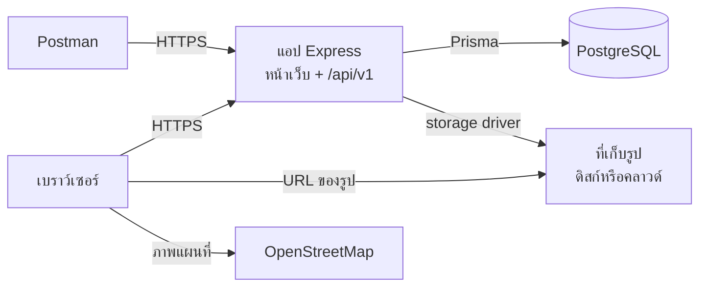
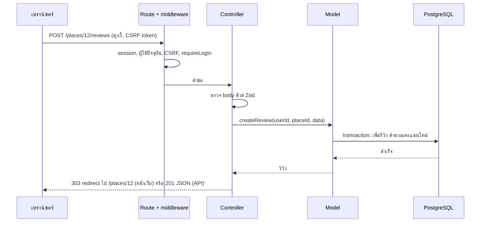
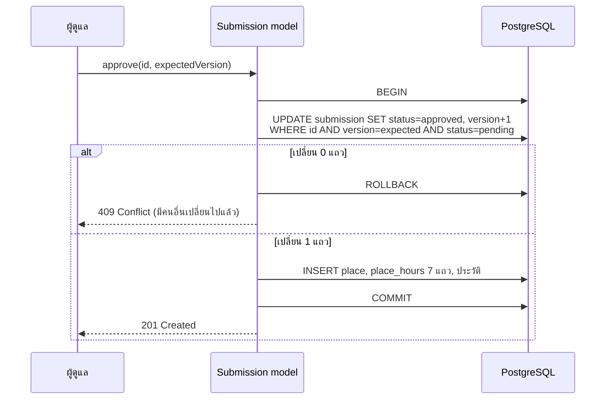
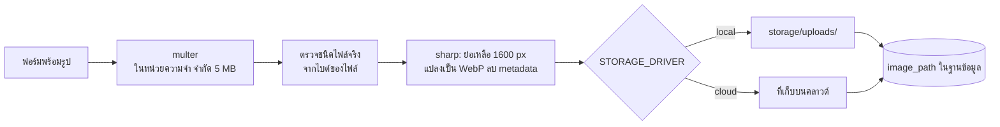
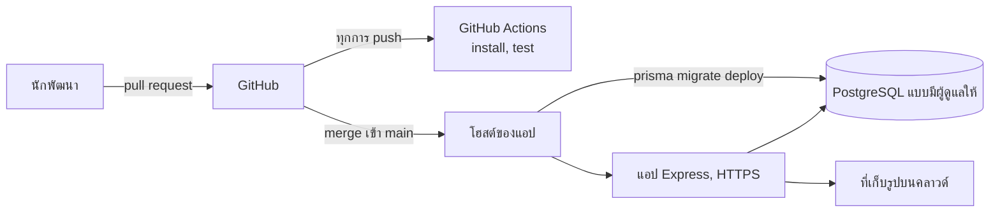

# สถาปัตยกรรม — วันนี้ไปไหนดี @ ลาดกระบัง

สถานะ: **ร่างเพื่อให้ทีมตรวจ** (พฤ. 12 พ.ย. 2569) ขั้นที่ 1 (พื้นฐาน)
ขั้นที่ 2 (บัญชีผู้ใช้) ขั้นที่ 3 (การสำรวจสถานที่) ขั้นที่ 4 (รีวิว รายการโปรด
การแจ้งข้อมูลผิด) และขั้นที่ 5 (การเสนอสถานที่และรูป) สร้างแล้ว หัวข้อที่เหลืออธิบายสิ่งที่ขั้นถัดไปจะเพิ่ม

เอกสารที่เกี่ยวข้อง: [PLAN.md](PLAN.md) (กำหนดการและขั้นตอน) ·
[DESIGN.md](DESIGN.md) (ฟีเจอร์ ฐานข้อมูล API)

## 1. ภาพรวมระบบ

แอป Node.js ตัวเดียวให้บริการทั้งหน้า HTML และ JSON API เก็บข้อมูลทั้งหมดใน
PostgreSQL และเก็บรูปที่อัปโหลดผ่านตัวจัดเก็บ (storage driver)



ไม่มีแอป front-end แยก และไม่มีบริการตัวที่สอง การขึ้นระบบจึงมีแค่
หนึ่ง process กับหนึ่งฐานข้อมูล

## 2. เทคโนโลยี

| ชั้น | สิ่งที่เลือก | เหตุผล |
|---|---|---|
| Runtime | Node.js 24, JavaScript (CommonJS, `require`) | รูปแบบเดียวกับแล็บในรายวิชา ไม่ต้อง build |
| Web framework | Express 5 | framework ของรายวิชา error จาก async ไปถึง error handler โดยไม่ต้องห่อ |
| Views | EJS เรนเดอร์ฝั่งเซิร์ฟเวอร์ | สอนในห้อง ใช้งานได้โดยไม่ต้องมี JavaScript ฝั่งผู้ใช้ |
| ฐานข้อมูล | PostgreSQL 17 | ข้อมูลเชิงสัมพันธ์ที่มีข้อบังคับเข้มงวด แล็บใช้ MySQL แต่โจทย์ให้แต่ละทีมเลือกเอง และข้อเสนอของเราเลือก PostgreSQL |
| การเข้าถึงข้อมูล | Prisma ORM 7 พร้อม driver adapter ของ PostgreSQL | ORM ที่สอนในห้อง (Day 07) schema อ่านง่ายไฟล์เดียว migration สร้างให้อัตโนมัติ |
| ฐานข้อมูลบนเครื่อง | Docker Compose หรือติดตั้งลงเครื่องโดยตรง | ใช้ Compose เหมือนในแล็บ เพื่อนร่วมทีมเปิดฐานข้อมูลได้ด้วยคำสั่งเดียว |
| การเข้าสู่ระบบ | session ฝั่งเซิร์ฟเวอร์พร้อมคุกกี้ (`express-session` เก็บใน PostgreSQL) | บทที่ 13 ออกจากระบบและเปลี่ยนบทบาทมีผลทันที |
| รหัสผ่าน | `bcrypt` | บทที่ 13 |
| การตรวจสอบข้อมูล | Zod | schema เดียวตรวจได้ทั้งฟอร์มและ body ของ API |
| การอัปโหลด | `multer` + `sharp` | จำกัดขนาดและชนิด ย่อขนาด แปลงเป็น WebP ลบข้อมูล GPS |
| ความปลอดภัย | `helmet`, `csrf-sync`, `express-rate-limit` | header และ CSP, CSRF token, จำกัดอัตราคำขอ |
| Log | `pino` | log แบบ JSON พร้อม request ID |
| การทดสอบ | Jest + `supertest` | บทที่ 10 ส่ง HTTP request จริงไปที่แอป |
| ทดสอบ API | Postman collection | บทที่ 11 |
| แผนที่ | Leaflet + OpenStreetMap | ฟรี ไม่ต้องใช้ API key |
| ฟอนต์ | Chonburi (หัวเรื่อง) และ IBM Plex Sans Thai Looped (เนื้อความ) จากแพ็กเกจ `@fontsource` | ให้บริการจากเว็บของเราเอง ไม่เรียกเซิร์ฟเวอร์ภายนอก |
| Package manager | npm | ใช้ในแล็บ |

## 3. ชั้นของระบบ (MVC)

```
Browser ──► routes ──► controllers ──► models ──► Prisma ──► PostgreSQL
              │             │             │
         middleware     views (EJS)   storage driver ──► disk / cloud
```

| ชั้น | หน้าที่ | ห้าม |
|---|---|---|
| `routes/` | จับคู่ URL + method กับ controller และติด middleware | มี logic |
| `middleware/` | session, ผู้ใช้ปัจจุบัน, CSRF, ตรวจบทบาท, จำกัดอัตรา, อัปโหลด, ข้อผิดพลาด | แตะฐานข้อมูล ยกเว้นการโหลดผู้ใช้ปัจจุบัน |
| `controllers/` | อ่านคำขอ ตรวจสอบข้อมูล เรียก model แล้วเรนเดอร์ view หรือส่ง JSON | มี query |
| `models/` | เข้าถึงข้อมูลผ่าน Prisma กฎทางธุรกิจ ตรวจความเป็นเจ้าของ transaction | รู้จัก `req` / `res` |
| `validation/` | Zod schema ของข้อมูลนำเข้าทุกชนิด | — |
| `views/` | เทมเพลต EJS | query ข้อมูล |

**Model** = `models/` + Prisma schema **View** = `views/`
**Controller** = `controllers/`

ไฟล์ controller แต่ละไฟล์มี handler สองแบบ: handler ของหน้าเว็บ (เรนเดอร์หรือ
redirect) และ handler ของ API (JSON) ทั้งสองเรียกฟังก์ชัน model ตัวเดียวกัน
กฎอย่าง "สมาชิกหนึ่งคนรีวิวสถานที่หนึ่งแห่งได้ครั้งเดียว" จึงเขียนไว้ที่เดียว

### โครงสร้างโฟลเดอร์

```
docker-compose.yaml      PostgreSQL สำหรับพัฒนาบนเครื่อง
docker/                  สคริปต์สร้างฐานข้อมูลทดสอบใน Docker
Dockerfile               image สำหรับระบบจริง (ขั้นที่ 8)
prisma.config.js         ค่าตั้งของ Prisma command-line
prisma/
  schema.prisma          ตาราง
  migrations/            SQL ที่สร้างขึ้น commit เข้า git
  seed.js                โหลดข้อมูลตั้งต้น (รันซ้ำได้ปลอดภัย)
  data/places.json       9 หมวดหมู่ + 30 สถานที่จริง
src/
  server.js              เริ่มทำงาน ปิดอย่างนุ่มนวล
  app.js                 สร้างแอป Express (การทดสอบก็ใช้)
  config/        env.js (อ่านและตรวจ .env), db.js (Prisma client)
  routes/        webRoutes.js, apiRoutes.js
  controllers/   auth, place, review (รวม favorite), report, submission, admin
  models/        user, place, review, favorite, report, submission, category
  validation/    หนึ่งไฟล์ schema ต่อหนึ่งฟีเจอร์
  middleware/    session, auth, csrf, rateLimit, upload, errors
  storage/       index.js, local.js, cloud.js (cloud.js ยังเป็นโครง จะเติมในขั้นที่ 8)
  utils/         AppError.js, validate.js, safeRedirect.js, pagination.js, openingHours.js, logger.js
  views/         หน้าเว็บ + partials/ และ helpers.js (ไอคอน ป้ายกำกับ การจัดรูปแบบ ที่ทุกเทมเพลตใช้)
public/          css/site.css, js/site.js, favicon และรูป (ไฟล์ของเว็บเท่านั้น)
storage/uploads/ รูปที่อัปโหลดตอนพัฒนา (git ไม่เก็บ)
test/            การทดสอบ Jest โดย support/ เก็บตัวช่วยเรื่องฐานข้อมูล
scripts/         create-admin.js (สร้างบัญชีผู้ดูแลจาก command line)
postman/         Postman collection
docs/
```

## 4. วงจรของคำขอ

middleware ทำงานตามลำดับนี้ ลำดับเป็นส่วนหนึ่งของการออกแบบ เช่น session
ต้องมีก่อนการตรวจ CSRF และไฟล์ static ถูกส่งก่อนที่จะสร้าง session

| # | Middleware | หน้าที่ |
|---|---|---|
| 1 | Request ID + logger | log ทุกบรรทัดมี ID เดียวกัน |
| 2 | `helmet` | security header และ Content Security Policy |
| 3 | Compression | ลดขนาดคำตอบ |
| 4 | ไฟล์ static | `public/`, ฟอนต์ที่ `/fonts`, ไลบรารีแผนที่ที่ `/vendor/leaflet` และ `/uploads` เมื่อเก็บรูปบนเครื่อง |
| 5 | Body parser | body ของฟอร์มและ JSON จำกัด 64 KB |
| 6 | Session | อ่านคุกกี้ โหลด session จาก PostgreSQL |
| 7 | ผู้ใช้ปัจจุบัน | โหลดผู้ใช้และบทบาทจากฐานข้อมูลสำหรับคำขอนี้ |
| 8 | CSRF | ตรวจ token บน POST, PUT, PATCH และ DELETE |
| 9 | Routes | middleware ราย route: จำกัดอัตรา, `requireLogin`, `requireAdmin`, อัปโหลด |
| 10 | 404 handler | ไม่มี route ใดตรง |
| 11 | Error handler | แปลงข้อผิดพลาดทุกชนิดเป็นหน้าเว็บหรือคำตอบ JSON |

บน route ที่มีการอัปโหลด body แบบ multipart ถูกอ่าน (ขั้น 9) ก่อนจะอ่าน
CSRF token ได้ route เหล่านั้นจึงรัน middleware อัปโหลดก่อน แล้วตรวจ CSRF ทันทีหลังจากนั้น



## 5. การยืนยันตัวตนและการกำหนดสิทธิ์

- **สมัครสมาชิก:** ตรวจข้อมูล → hash รหัสผ่านด้วย bcrypt → สร้างผู้ใช้เป็น
  `member` → เริ่ม session
- **เข้าสู่ระบบ:** จำกัดอัตรา → ค้นหาอีเมล → เทียบ hash (ถ้าไม่พบอีเมลจะเทียบกับ
  hash หลอก เวลาที่ใช้จึงไม่บอกว่าอีเมลใดมีอยู่) → ออก session ID ใหม่ →
  เก็บเพียง `userId` ใน session
- **ทุกคำขอ:** โหลดผู้ใช้ปัจจุบันจากฐานข้อมูลด้วย `userId` ไม่อ่านบทบาทจาก
  คุกกี้หรือ session การถอดสิทธิ์ผู้ดูแลจึงมีผลทันทีในคลิกถัดไป
- **ออกจากระบบ:** ลบแถว session และล้างคุกกี้

| การตรวจ | ที่ไหน | เมื่อไม่ผ่าน |
|---|---|---|
| เข้าสู่ระบบแล้ว | middleware `requireLogin` | หน้าเว็บ: redirect ไป `/login` API: 401 |
| เป็นผู้ดูแล | middleware `requireAdmin` | 403 |
| เป็นเจ้าของข้อมูล | ฟังก์ชันใน model | 404 สำหรับข้อมูลส่วนตัว เพื่อไม่เปิดเผยว่ามีอยู่ |

คุกกี้ session: `HttpOnly`, `SameSite=Lax`, `Secure` บนระบบจริง อายุ 7 วัน
ชื่อคุกกี้ไม่บอกว่าใช้ framework อะไร

## 6. ความถูกต้องของข้อมูล

- ฐานข้อมูลบังคับสิ่งที่บังคับได้: foreign key, unique key, enum และ
  `CHECK` constraint ส่วน model บังคับที่เหลือ: ความเป็นเจ้าของ การเปลี่ยนสถานะ
  ที่อนุญาต และ version
- **Transaction** ครอบทุกการทำงานที่เขียนมากกว่าหนึ่งแถว
- **Optimistic concurrency** สำหรับรายการที่เสนอ: ทุกแถวมี `version` การแก้ไข
  ต้องระบุ version ที่ใช้เป็นฐาน และสำเร็จเฉพาะเมื่อ version นั้นยังเป็นปัจจุบัน



## 7. ข้อผิดพลาด

ข้อผิดพลาดทั้งหมดผ่าน handler ตัวเดียว

- model และ controller โยน `AppError` ที่มี HTTP status, `code` ที่คงที่
  และข้อความที่แสดงให้ผู้ใช้เห็นได้อย่างปลอดภัย
- ข้อผิดพลาดของฐานข้อมูลที่รู้จักถูกแปลง: ข้อมูลซ้ำ → 409 ไม่พบข้อมูล → 404
- ข้อผิดพลาดอื่นถูกบันทึก log พร้อม stack trace และแสดงเป็น 500 แบบทั่วไป

| ผู้เรียก | คำตอบ |
|---|---|
| หน้าเว็บ ข้อมูลไม่ผ่านการตรวจ | ฟอร์มเดิมอีกครั้งพร้อมข้อมูลที่กรอกไว้ และข้อความข้างแต่ละช่อง |
| หน้าเว็บ ข้อผิดพลาดอื่น | หน้าข้อผิดพลาดพร้อม status และข้อความสั้น ๆ |
| API | `{ "error": { "code", "message", "details" } }` |

## 8. การเก็บรูป



ตัวจัดเก็บทั้งสองแบบมีฟังก์ชันสองตัวเหมือนกัน คือ `save(buffer)` และ `remove(path)`
โค้ดส่วนอื่นจึงไม่ต้องรู้ว่าไฟล์อยู่ที่ไหน ฐานข้อมูลเก็บเพียง path หรือ URL ที่ได้

## 9. ค่าตั้งและสภาพแวดล้อม

`config/env.js` อ่าน `.env` ตรวจทุกค่าด้วย Zod และหยุดแอปพร้อมข้อความชัดเจน
หากค่าใดหายหรือผิด

| ตัวแปร | หน้าที่ |
|---|---|
| `NODE_ENV` | `development`, `test` หรือ `production` |
| `PORT` | port ที่รอรับคำขอ |
| `DATABASE_URL` | connection string ของ PostgreSQL |
| `SESSION_SECRET` | ใช้ลงนามคุกกี้ session อย่างน้อย 32 ตัวอักษร |
| `PUBLIC_ORIGIN` | ที่อยู่ HTTPS สาธารณะ จำเป็นบนระบบจริง |
| `TRUST_PROXY` | ตั้งเมื่อแอปอยู่หลัง proxy ของโฮสต์ |
| `STORAGE_DRIVER` | `local` หรือ `cloud` |
| key ของที่เก็บบนคลาวด์ | เฉพาะเมื่อ `STORAGE_DRIVER=cloud` |
| `TEST_DATABASE_URL` | ฐานข้อมูลแยกที่ Jest ใช้ |

| สภาพแวดล้อม | ฐานข้อมูล | รูป | หมายเหตุ |
|---|---|---|---|
| Development | PostgreSQL บนเครื่อง (Docker หรือติดตั้งตรง) | `storage/uploads/` | รีสตาร์ตอัตโนมัติเมื่อไฟล์เปลี่ยน |
| Test | ฐานข้อมูลแยกบนเครื่อง ล้างก่อนทุกครั้งที่รัน | โฟลเดอร์ชั่วคราว | ผ่อนการจำกัดอัตรา |
| Production | PostgreSQL แบบมีผู้ดูแลให้ | ที่เก็บบนคลาวด์ | HTTPS คุกกี้แบบ secure รัน migration ตอนขึ้นระบบ |

## 10. ความปลอดภัย

| ความเสี่ยง | การป้องกัน |
|---|---|
| รหัสผ่านถูกขโมย | bcrypt (cost 12) ความยาว 8–72 ตัวอักษร |
| ตรวจว่าอีเมลมีบัญชีหรือไม่ / ใช้ bcrypt ถ่วงเซิร์ฟเวอร์ | สมัครสมาชิกได้ 20 ครั้งต่อชั่วโมงต่อ IP |
| การเดารหัสผ่าน | นับเฉพาะการเข้าสู่ระบบที่ผิด: 5 ครั้งต่อบัญชีต่อ IP และ 30 ครั้งต่อ IP ใน 15 นาที ครั้งถัดไปได้ 429 อีเมลผิดและรหัสผ่านผิดได้ข้อความเดียวกัน |
| session ถูกขโมย / ถูกตรึง | ค่าคุกกี้ตามด้านบน session ID ใหม่เมื่อเข้าสู่ระบบ ทำลายเมื่อออกจากระบบ เปลี่ยนรหัสผ่านแล้วเพิ่ม `session_version` ของบัญชี session เก่าทุกอันจึงใช้ไม่ได้ แม้มีคำขอค้างเขียนกลับมา session ที่ออกจากระบบแล้วจะไม่ถูกเขียนกลับ |
| CSRF | token ในทุกฟอร์ม และบังคับในทุกคำขอที่เปลี่ยนข้อมูล |
| SQL injection | ทุก query ผ่าน Prisma แบบมีพารามิเตอร์ escape อักขระพิเศษในการค้นหา |
| XSS | EJS escape ผลลัพธ์ มี Content Security Policy ไม่มี inline script สคริปต์ ฟอนต์ และสไตล์โหลดจากเว็บของเราเท่านั้น ภายนอกอนุญาตเฉพาะรูปแผนที่จาก `tile.openstreetmap.org` ลิงก์ของสถานที่ต้องขึ้นต้นด้วย `http(s)://` (บังคับในฐานข้อมูล) |
| สวมรอยเป็นผู้ใช้อื่น | user ID มาจาก session เท่านั้น model ตรวจความเป็นเจ้าของ |
| สิทธิ์ผู้ดูแลค้าง | โหลดบทบาทจากฐานข้อมูลใหม่ทุกคำขอ |
| ไฟล์อัปโหลดอันตราย | จำกัดขนาด ตรวจชนิดจากไบต์ของไฟล์ เข้ารหัสใหม่ ตั้งชื่อสุ่ม |
| เปิดเผยรายละเอียดภายใน | ข้อความข้อผิดพลาดแบบทั่วไป รายละเอียดอยู่ใน log ของเซิร์ฟเวอร์เท่านั้น |
| ความลับหลุดเข้า git | commit เฉพาะ `.env.example` |

## 11. การขึ้นระบบ



- `GET /healthz` ตรวจฐานข้อมูลแล้วตอบ 200 หรือ 503
- ปิดอย่างนุ่มนวล: หยุดรับคำขอใหม่ ทำคำขอที่ค้างให้เสร็จ ปิดการเชื่อมต่อ
- migration รันเป็นขั้นตอนหนึ่งของการขึ้นระบบ ไม่รันตอนแอปเริ่มทำงาน
- มี `Dockerfile` เพื่อให้แอปทำงานเหมือนกันบนทุกโฮสต์
- การสำรองฐานข้อมูลมาจากผู้ให้บริการ PostgreSQL
- โฮสต์ที่แนะนำ (เรื่อง B และ C ที่ยังไม่ตัดสินใน PLAN.md): Render สำหรับแอป
  Neon สำหรับ PostgreSQL และ Cloudinary สำหรับรูป

## 12. การทดสอบ

การทดสอบอัตโนมัติรันด้วย Jest กับฐานข้อมูลทดสอบที่แยกต่างหาก

| ระดับ | ทดสอบอะไร |
|---|---|
| Unit | schema การตรวจข้อมูล ตรรกะเวลาเปิดปิด ("เปิดอยู่ตอนนี้" เวลาข้ามคืน) |
| API | ทุก endpoint: สำเร็จ ข้อมูลไม่ถูกต้อง ยังไม่เข้าสู่ระบบ บทบาทผิด ไม่ใช่เจ้าของ |
| Workflow | เสนอ → ส่งกลับ → แก้ไข → ส่งใหม่ → อนุมัติ อนุมัติสองครั้งพร้อมกันได้สถานที่เดียว อนุมัติล้มเหลวไม่ทิ้งอะไรไว้ |
| ความปลอดภัย | บังคับ CSRF จำกัดอัตรา ค่าคุกกี้ session ข้อจำกัดการอัปโหลด |
| ด้วยมือ | ทุกหน้าที่ความกว้างมือถือ แท็บเล็ต และเดสก์ท็อป ทุก endpoint จาก Postman |

## 13. หัวข้อในรายวิชาที่ครอบคลุม

| บท | หัวข้อ | อยู่ส่วนไหนของโครงงาน |
|---|---|---|
| 2 | Git | branch ตามฟีเจอร์และ pull request หนึ่งอันต่อขั้น |
| 3 | Docker | `docker-compose.yaml` สำหรับ PostgreSQL และ `Dockerfile` สำหรับแอป |
| 4 | Express, EJS, server-side rendering | ฝั่งเว็บทั้งหมด |
| 6 | Middleware | หัวข้อ 4 |
| 6 | Environment variables | หัวข้อ 9 |
| 6 | CRUD และ soft delete | สถานที่ถูกยกเลิกการเผยแพร่ และรีวิวถูกทำเครื่องหมายว่าลบ ไม่ถูกลบจริง |
| 7 | SQL: join, constraint, aggregate, transaction | หัวข้อ 6, `CHECK` constraint ใน migration, คะแนนเฉลี่ย |
| 7 | ORM (Prisma) | การเข้าถึงข้อมูลทั้งหมด |
| 10 | Unit testing ด้วย Jest | หัวข้อ 12 |
| 11 | API testing | Postman collection |
| 12 | MVC | หัวข้อ 3 ใช้ชื่อโฟลเดอร์เดียวกับแล็บ |
| 13 | Cookies, sessions, bcrypt | หัวข้อ 5 |
| 14 | JWT | พิจารณาแล้วไม่ใช้: เว็บเรนเดอร์ฝั่งเซิร์ฟเวอร์ และ session ยุติได้ทันที ขณะที่ token ยังใช้ได้จนหมดอายุ |
| บทนำ | Form validation, error handling, authorization | Zod, หัวข้อ 7, หัวข้อ 5 |
| บทนำ | Deployment | หัวข้อ 11 |
| บทนำ | Single sign-on | ไม่ได้วางแผนไว้ "เข้าสู่ระบบด้วย Google" เป็นส่วนเสริมที่อาจทำ |
