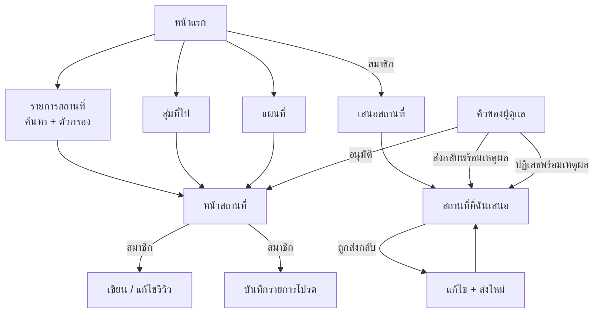
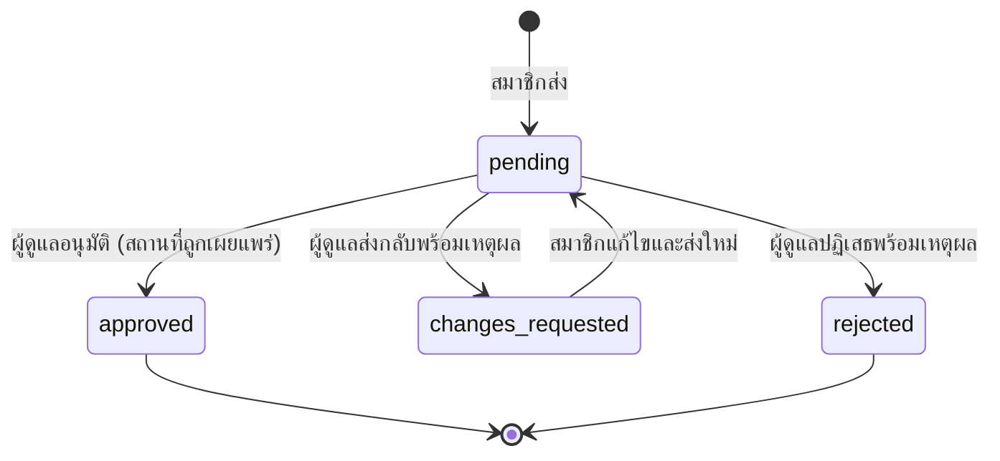
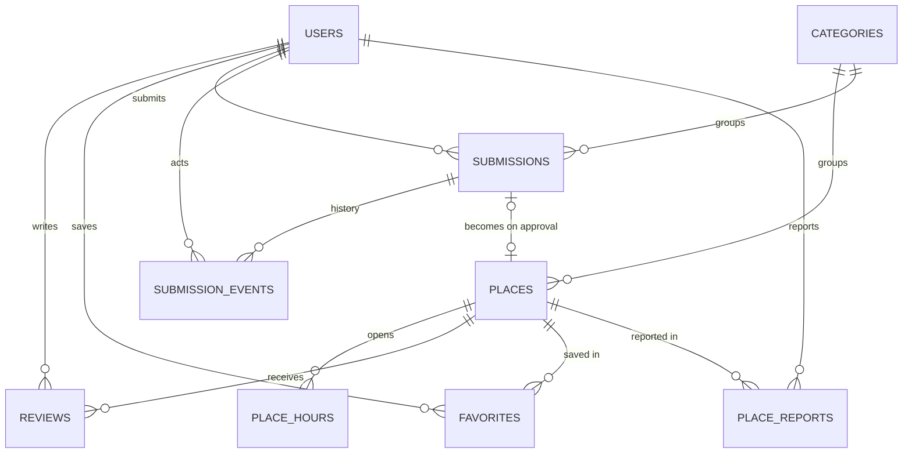

# การออกแบบ — วันนี้ไปไหนดี @ ลาดกระบัง

สถานะ: **ร่างเพื่อให้ทีมตรวจ** (พฤ. 12 พ.ย. 2569) ฐานข้อมูลในหัวข้อ 3
(ขั้นที่ 1) บัญชีผู้ใช้ (ขั้นที่ 2) การสำรวจสถานที่ (ขั้นที่ 3) และรีวิว รายการโปรด
การแจ้งข้อมูลผิด (ขั้นที่ 4) สร้างแล้ว
ส่วนที่เหลือยังเป็นแผน

เอกสารที่เกี่ยวข้อง: [PLAN.md](PLAN.md) (กำหนดการและขั้นตอน) ·
[ARCHITECTURE.md](ARCHITECTURE.md) (สร้างอย่างไร)

ชื่อตาราง คอลัมน์ ค่าสถานะ และ endpoint เขียนเป็นภาษาอังกฤษ เพราะเป็นชื่อเดียวกับในโค้ด

## 1. ผลิตภัณฑ์

คู่มือสถานที่ในเขตลาดกระบังภาษาไทย เขียนโดยคนที่อาศัยอยู่ที่นี่
ผู้เยี่ยมชมค้นหาและเลือกดูสถานที่ สมาชิกรีวิวสถานที่ บันทึกรายการโปรด
และเสนอสถานที่ใหม่ ผู้ดูแลตรวจทุกรายการที่เสนอก่อนเผยแพร่
ข้อมูลในเว็บจึงเชื่อถือได้

**ปัญหาที่แก้:** ข้อมูลร้านค้า คาเฟ่ และบริการในลาดกระบังกระจัดกระจาย
และมักล้าสมัย นักศึกษาและผู้ที่เพิ่งย้ายมาถามกันว่า "วันนี้ไปไหนดี"
แต่ไม่มีแหล่งเดียวที่เชื่อถือได้ให้ดู

### บทบาท

| บทบาท | ทำอะไรได้ |
|---|---|
| ผู้เยี่ยมชม (Visitor) | ค้นหา กรอง ดูสถานที่ รีวิว แผนที่ สุ่มที่ไป |
| สมาชิก (Member) | ทุกอย่างที่ผู้เยี่ยมชมทำได้ และเขียนรีวิว บันทึกรายการโปรด เสนอสถานที่ แจ้งข้อมูลผิด |
| ผู้ดูแล (Admin) | ทุกอย่างที่สมาชิกทำได้ และอนุมัติ / ส่งกลับ / ปฏิเสธรายการที่เสนอ แก้ไขและยกเลิกการเผยแพร่สถานที่ ลบรีวิว จัดการหมวดหมู่ |

ใครก็สมัครเป็นสมาชิกได้ ผู้ดูแลสร้างได้จาก command line เท่านั้น

### ฟีเจอร์ในเวอร์ชัน 1

- รายการสถานที่: ค้นหาด้วยข้อความ กรองตามหมวดหมู่และ "เปิดอยู่ตอนนี้" เรียงลำดับ แบ่งหน้า
- หน้าสถานที่: รายละเอียด เบอร์โทรและลิงก์ เวลาเปิดปิดรายสัปดาห์ รูป หมุดบนแผนที่ ปุ่มนำทาง รีวิว สถานที่ที่เกี่ยวข้อง
- หน้าแรก: สถานที่แนะนำ (ผู้ดูแลเลือก) คะแนนสูงสุด และปุ่ม **"สุ่มที่ไป"**
- แผนที่ของทุกสถานที่ที่มีพิกัด
- บัญชีผู้ใช้: สมัคร เข้าสู่ระบบ ออกจากระบบ โปรไฟล์ แก้ไขชื่อผู้ใช้ เปลี่ยนรหัสผ่าน
- รีวิว: สมาชิกหนึ่งคนต่อสถานที่หนึ่งแห่งรีวิวได้หนึ่งครั้ง 1–5 ดาว แก้ไข ลบ
- รายการโปรด: บันทึกและลบ
- แจ้งข้อมูลผิด: สมาชิกแจ้งว่าสถานที่ปิดกิจการ ย้าย หรือข้อมูลไม่ถูกต้อง ให้ผู้ดูแลตรวจ
- การเสนอสถานที่: เสนอพร้อมรูปและปักหมุดตำแหน่งบนแผนที่ ติดตามสถานะ แก้ไขและส่งใหม่เมื่อถูกส่งกลับ
- ผู้ดูแล: คิวรายการที่เสนอ เพิ่มสถานที่โดยตรง จัดการสถานที่ ดูแลรีวิว รายการแจ้งข้อมูลผิด หมวดหมู่

### ไม่อยู่ในเวอร์ชัน 1

รีเซ็ตรหัสผ่านทางอีเมล ยืนยันอีเมล หลายรูปต่อสถานที่
สมาชิกแก้ไขสถานที่ที่เผยแพร่แล้ว หน้าจอภาษาอังกฤษ

## 2. ลำดับการใช้งาน

### ขั้นตอนการเสนอสถานที่

| สถานะ | สมาชิกทำได้ | ผู้ดูแลทำได้ |
|---|---|---|
| `pending` (รอตรวจ) | ดู | อนุมัติ (ปรับตำแหน่งหมุดก่อนได้) ส่งกลับ ปฏิเสธ |
| `changes_requested` (ถูกส่งกลับให้แก้) | ดู แก้ไข ส่งใหม่ | ดู |
| `approved` (อนุมัติแล้ว) | ดู เปิดหน้าสถานที่ที่เผยแพร่ | ดู |
| `rejected` (ปฏิเสธ) | ดูเหตุผล | ดู |

`rejected` เป็นสถานะที่เพิ่มจากสไลด์ข้อเสนอโครงงาน หากไม่มี ผู้ดูแลจะไม่มีทาง
ปิดรายการที่เป็นสแปมหรืออยู่นอกเขต

### สถานะของรีวิว

| สถานะ | ความหมาย | แสดงต่อสาธารณะ | ผู้เขียนทำได้ |
|---|---|---|---|
| `active` | ปกติ | ใช่ | แก้ไข ลบ |
| `deleted` | ผู้เขียนลบเอง | ไม่ | เขียนใหม่ได้ (ใช้แถวเดิม) |
| `removed` | ผู้ดูแลลบ พร้อมเหตุผล | ไม่ | ไม่มี |

## 3. ฐานข้อมูล

มีสิบตาราง (รายวิชากำหนดอย่างน้อยสามตาราง) เก้าตารางสร้างแล้วในขั้นที่ 1
คอลัมน์ `phone` และ `website_url` เพิ่มแล้วด้วย migration ในขั้นที่ 3
ส่วน `place_reports` เพิ่มแล้วในขั้นที่ 4 ทุกตารางมี primary key เป็น `id`
ชนิด integer เว้นแต่ระบุ key อื่นไว้ `created_at` และ `updated_at` เป็น `timestamptz`

### users

| คอลัมน์ | ชนิด | กฎ |
|---|---|---|
| id | integer | Primary key |
| username | varchar(50) | 3–50 ตัวอักษร เป็นชื่อที่แสดง ซ้ำกันได้ |
| email | varchar(254) | ห้ามซ้ำ เก็บเป็นตัวพิมพ์เล็ก |
| password_hash | varchar(100) | bcrypt hash ไม่ถูกส่งออกจาก endpoint ใดเลย |
| role | enum | `member` (ค่าเริ่มต้น) หรือ `admin` |
| created_at, updated_at | timestamptz | |

### categories

| คอลัมน์ | ชนิด | กฎ |
|---|---|---|
| id | integer | Primary key |
| name | varchar(80) | ห้ามซ้ำ โดยไม่สนตัวพิมพ์ใหญ่ / เล็ก |
| created_at | timestamptz | |

### places

| คอลัมน์ | ชนิด | กฎ |
|---|---|---|
| id | integer | Primary key |
| category_id | integer | Foreign key → categories ลบหมวดหมู่ไม่ได้ขณะที่ยังถูกใช้อยู่ |
| name | varchar(200) | จำเป็น |
| description | text | จำเป็น ไม่เกิน 5000 ตัวอักษร |
| address | varchar(500) | จำเป็น |
| latitude, longitude | decimal(9,6) | มีทั้งคู่หรือว่างทั้งคู่ อยู่ในช่วงที่ถูกต้อง |
| image_path | varchar(500) | ไม่บังคับ path หรือ URL ของรูป |
| phone | varchar(30) | ไม่บังคับ เบอร์โทรของสถานที่ |
| website_url | varchar(500) | ไม่บังคับ เว็บไซต์ หน้า Facebook หรือ LINE ต้องขึ้นต้นด้วย `http://` หรือ `https://` |
| status | enum | `published` (เผยแพร่) หรือ `unpublished` (ไม่เผยแพร่) |
| featured_order | integer | ไม่บังคับ เป็นบวก ค่าน้อยแสดงก่อนในหน้าแรก |
| rating_avg | decimal(3,2) | ว่างเมื่อไม่มีรีวิวที่ใช้งานอยู่ |
| rating_count | integer | จำนวนรีวิวที่ใช้งานอยู่ ค่าเริ่มต้น 0 |
| created_by | integer | Foreign key → users (ผู้ดูแลที่เผยแพร่) ว่างสำหรับสถานที่ตั้งต้นที่โหลดจาก seed |
| created_at, updated_at | timestamptz | |

Index: `(status, category_id)`, `(status, rating_avg)`

### place_hours

| คอลัมน์ | ชนิด | กฎ |
|---|---|---|
| place_id | integer | Foreign key → places เป็นส่วนหนึ่งของ primary key |
| weekday | smallint | 0 (อาทิตย์) ถึง 6 (เสาร์) เป็นส่วนหนึ่งของ primary key |
| state | enum | `open` (เปิด), `closed` (ปิด) หรือ `unknown` (ไม่ทราบ) |
| opens_at, closes_at | time | จำเป็นเมื่อ `open` ว่างในกรณีอื่น |
| closes_next_day | boolean | true เมื่อเวลาปิดเลยเที่ยงคืน |

ทุกสถานที่มีเจ็ดแถวพอดี และเขียนพร้อมกันทั้งเจ็ดแถว

### reviews

| คอลัมน์ | ชนิด | กฎ |
|---|---|---|
| id | integer | Primary key |
| user_id | integer | Foreign key → users |
| place_id | integer | Foreign key → places |
| rating | smallint | 1 ถึง 5 |
| comment | varchar(2000) | ไม่บังคับ |
| status | enum | `active`, `deleted` หรือ `removed` |
| removed_by | integer | Foreign key → users มีค่าเฉพาะเมื่อ `removed` |
| removed_reason | varchar(500) | จำเป็นเมื่อ `removed` |
| created_at, updated_at | timestamptz | |

Unique: `(user_id, place_id)` Index: `(place_id, status)`

### favorites

| คอลัมน์ | ชนิด | กฎ |
|---|---|---|
| user_id | integer | Foreign key → users เป็นส่วนหนึ่งของ primary key |
| place_id | integer | Foreign key → places เป็นส่วนหนึ่งของ primary key |
| created_at | timestamptz | |

### submissions

| คอลัมน์ | ชนิด | กฎ |
|---|---|---|
| id | integer | Primary key |
| user_id | integer | Foreign key → users (สมาชิกที่เสนอ) |
| category_id | integer | Foreign key → categories |
| name, description, address, image_path, phone, website_url | | ชนิดและกฎเหมือน `places` |
| latitude, longitude | decimal(9,6) | **จำเป็น** สมาชิกต้องปักหมุดบนแผนที่ และต้องอยู่ในบริเวณลาดกระบัง |
| hours | jsonb | เจ็ดรายการ หนึ่งรายการต่อหนึ่งวัน |
| status | enum | `pending`, `changes_requested`, `approved` หรือ `rejected` |
| version | integer | เริ่มที่ 1 เพิ่มขึ้นทุกครั้งที่มีการเปลี่ยนแปลง |
| review_note | varchar(1000) | เหตุผลล่าสุดของผู้ดูแล |
| place_id | integer | Foreign key → places ห้ามซ้ำ มีค่าเฉพาะเมื่อ `approved` |
| created_at, updated_at | timestamptz | |

Index: `(status, created_at)`, `(user_id)`

### submission_events

| คอลัมน์ | ชนิด | กฎ |
|---|---|---|
| id | integer | Primary key |
| submission_id | integer | Foreign key → submissions |
| actor_id | integer | Foreign key → users |
| action | enum | `submitted`, `edited`, `resubmitted`, `returned`, `approved`, `rejected` |
| note | varchar(1000) | เหตุผล สำหรับ `returned` และ `rejected` และข้อความว่าผู้ดูแลย้ายหมุด สำหรับ `approved` |
| snapshot | jsonb | เนื้อหาของรายการที่เสนอ ณ ขณะนั้น |
| created_at | timestamptz | |

แถวในตารางนี้มีแต่เพิ่ม ไม่มีการแก้ไข

### place_reports

| คอลัมน์ | ชนิด | กฎ |
|---|---|---|
| id | integer | Primary key |
| place_id | integer | Foreign key → places |
| user_id | integer | Foreign key → users (สมาชิกที่แจ้ง) |
| reason | enum | `closed` (ปิดกิจการ), `moved` (ย้ายที่), `wrong_info` (ข้อมูลผิด) หรือ `other` (อื่น ๆ) |
| details | varchar(1000) | คำอธิบาย จำเป็นเมื่อเหตุผลเป็น `other` |
| status | enum | `open` (รอตรวจ), `resolved` (แก้ไขแล้ว) หรือ `dismissed` (ไม่ดำเนินการ) |
| resolved_by | integer | Foreign key → users มีค่าเมื่อไม่ใช่ `open` |
| created_at, resolved_at | timestamptz | |

Index: `(status, created_at)` สมาชิกหนึ่งคนมีรายงานที่ยัง `open` ได้หนึ่งรายการต่อสถานที่

### sessions

ตารางนี้เป็นของตัวจัดเก็บ session (`connect-pg-simple` เพิ่มในขั้นที่ 2)
ซึ่งอ่านและเขียนตารางนี้โดยตรง

| คอลัมน์ | ชนิด | กฎ |
|---|---|---|
| sid | varchar | Primary key คือ session ID |
| sess | json | ข้อมูล session: user ID ของผู้ที่เข้าสู่ระบบ และ CSRF token |
| expire | timestamp | เวลาที่ session หมดอายุ มี index |

### เหตุผลในการออกแบบ

- **รายการที่เสนอแยกเป็นตารางของตัวเอง ไม่ใช่สถานะหนึ่งใน `places`**
  การค้นหาสาธารณะอ่านเฉพาะ `places` ข้อเสนอที่ยังไม่อนุมัติหรือถูกปฏิเสธ
  จึงไม่มีทางหลุดไปอยู่ในผลค้นหาเพราะมีคนลืมใส่เงื่อนไข `WHERE`
- **ลบแบบ soft delete ทุกที่** สถานที่ถูกยกเลิกการเผยแพร่ และรีวิวถูกทำเครื่องหมาย
  `deleted` หรือ `removed` สิ่งที่สมาชิกเขียนไม่ถูกทำลาย และสมาชิกเลี่ยงการตรวจ
  ด้วยการลบรีวิวที่ถูกผู้ดูแลลบแล้วเขียนใหม่ไม่ได้ เพราะแถว (ผู้ใช้, สถานที่) ยังอยู่
- **เวลาเปิดปิดเก็บเป็นแถวสำหรับสถานที่ และเป็น JSON สำหรับรายการที่เสนอ**
  "เปิดอยู่ตอนนี้" ต้องกรองใน SQL สถานที่จึงต้องมีแถวจริง รายการที่เสนอเป็นแค่
  ข้อเสนอที่ถูกคัดลอกเมื่ออนุมัติ JSON จึงเพียงพอ
- **`rating_avg` และ `rating_count` เก็บไว้ในสถานที่** คำนวณใหม่จากตาราง reviews
  (ไม่ใช้การบวกเพิ่ม) ภายใน transaction เดียวกับการเปลี่ยนแปลงรีวิวทุกครั้ง
  ค่าจึงไม่คลาดเคลื่อน และการเรียงตามคะแนนเป็นแค่ query ธรรมดาที่ใช้ index
- **"เปิดอยู่ตอนนี้" คิดที่เดียว ใช้สองทาง** กฎเดียวกันใน `utils/openingHours.js`
  ให้ทั้งป้ายสถานะบนการ์ด และตัวกรองในฐานข้อมูล (จึงใช้ร่วมกับการค้นหา การเรียง
  และการแบ่งหน้าได้) แถวที่ปิดหลังเที่ยงคืนครอบคลุมช่วงเช้ามืดของวันถัดไปด้วย
  และการทดสอบตรวจว่าสองทางนี้ให้ผลตรงกันเสมอ
- **การค้นหา escape อักขระ `%` และ `_` เอง** เพราะ Prisma ไม่ทำให้ และคำค้นที่เป็น
  ส่วนหนึ่งของ "เขตลาดกระบัง กรุงเทพมหานคร" (เช่น "ตลาด") จะไม่ค้นในที่อยู่
  ไม่เช่นนั้นจะตรงกับทุกสถานที่
- **เวลามีสองแบบ** เวลาที่เกิดเหตุการณ์เป็น `timestamptz` แบบ UTC
  เวลาเปิดปิดเป็นเวลาตามนาฬิกาในเขตเวลากรุงเทพฯ เพราะ "เปิด 09:00"
  ไม่ขึ้นกับว่าเซิร์ฟเวอร์อยู่ที่ไหน
- **สมาชิกปักหมุด ผู้ดูแลปรับได้** ฟอร์มเสนอสถานที่มีแผนที่ให้แตะหรือลากหมุด
  และส่งไม่ได้ถ้าไม่มีหมุด ผู้ดูแลลากหมุดให้ตรงได้ทั้งตอนตรวจและหลังเผยแพร่
  การย้ายหมุดตอนอนุมัติถูกบันทึกในประวัติ สมาชิกจึงเห็นว่าหมุดถูกย้าย
  แผนที่ต้องใช้ JavaScript ฟอร์มจึงแสดงช่องละติจูดและลองจิจูดเป็นช่องธรรมดาด้วย
- **ทุกการเปลี่ยนรีวิวล็อกแถวของสถานที่ก่อน** แล้วคำนวณคะแนนเฉลี่ยใหม่ใน transaction เดียวกัน
  สมาชิกหลายคนรีวิวสถานที่เดียวกันพร้อมกันจึงต้องรอกัน และค่าเฉลี่ยไม่มีวันตกหล่น
  (มีการทดสอบที่ส่งรีวิวหกรายการพร้อมกัน)
- **ปุ่มบันทึกสถานที่ใช้ได้ทั้งมีและไม่มี JavaScript** มี JavaScript จะเรียก
  `PUT`/`DELETE /api/v1/me/favorites/:placeId` โดยไม่โหลดหน้าใหม่ ไม่มีก็ส่งฟอร์มตามปกติ
- **ปุ่มนำทางไม่ต้องใช้ API key** เป็นลิงก์ธรรมดาที่เปิด Google Maps พร้อมพิกัด
  ของหมุด แสดงเฉพาะสถานที่ที่มีหมุด
- **ผู้ดูแลเพิ่มสถานที่ได้โดยตรง** ไม่ต้องเสนอในฐานะสมาชิกแล้วอนุมัติเอง
  สถานที่ที่เพิ่มแบบนี้ไม่มีรายการที่เสนอคู่กัน
- **การแจ้งข้อมูลผิดไม่แก้ไขสถานที่เอง** เป็นเพียงข้อความถึงผู้ดูแล ซึ่งเป็นผู้แก้ไข
  หรือยกเลิกการเผยแพร่สถานที่ แล้วปิดรายงาน
- กฎที่ Prisma schema เขียนไม่ได้ (ช่วงคะแนน คู่พิกัด ชื่อห้ามซ้ำโดยไม่สนตัวพิมพ์)
  เพิ่มเป็น `CHECK` constraint และ index ของ SQL ในไฟล์ migration

### Transaction

| การทำงาน | สิ่งที่ต้องเกิดพร้อมกัน |
|---|---|
| อนุมัติรายการที่เสนอ | ทำเครื่องหมายว่าอนุมัติ (เฉพาะเมื่อยังเป็น `pending` ที่ version ที่ผู้ดูแลเห็น) → สร้างสถานที่ (ใช้ตำแหน่งหมุดที่ผู้ดูแลปรับแล้ว ถ้ามี) → สร้างแถวเวลาเปิดปิด 7 แถว → บันทึกประวัติ รวมถึงการย้ายหมุด หากขั้นใดล้มเหลว ย้อนกลับทั้งหมด |
| ส่งกลับ / ปฏิเสธ / แก้ไข / ส่งใหม่ | เปลี่ยนรายการที่เสนอ (ตรวจ version แบบเดียวกัน) → บันทึกประวัติ |
| สร้าง / แก้ไข / ลบ / ผู้ดูแลลบรีวิว | เปลี่ยนรีวิว → คำนวณคะแนนของสถานที่ใหม่ |
| ผู้ดูแลแก้เวลาเปิดปิดของสถานที่ | แทนที่ทั้งเจ็ดแถวพร้อมกัน |

## 4. API

ทุก path ขึ้นต้นด้วย `/api/v1` คำขอและคำตอบเป็น JSON ยกเว้น endpoint
การเสนอสถานที่ที่แนบรูป ซึ่งใช้ `multipart/form-data`

- สำเร็จ: `{ "data": ... }` รายการเพิ่ม `"meta": { "page", "pageSize", "total" }`
- ผิดพลาด: `{ "error": { "code", "message", "details" } }`
- สถานะการเข้าสู่ระบบอยู่ในคุกกี้ session คำขอที่เปลี่ยนข้อมูลต้องส่ง
  CSRF token ใน header `X-CSRF-Token` ด้วย

### สาธารณะ

| Method | Path | คำอธิบาย | Status |
|---|---|---|---|
| GET | `/auth/csrf` | ขอ CSRF token | 200 |
| POST | `/auth/register` | สมัครสมาชิก บทบาทเป็น `member` เสมอ | 201 |
| POST | `/auth/login` | เข้าสู่ระบบ เริ่ม session ใหม่ | 200 |
| GET | `/categories` | หมวดหมู่พร้อมจำนวนสถานที่ | 200 |
| GET | `/places` | ค้นหาและกรองสถานที่ที่เผยแพร่ | 200 |
| GET | `/places/map` | สถานที่ที่มีพิกัด | 200 |
| GET | `/places/random` | สุ่มสถานที่หนึ่งแห่ง (เลือกหมวดหมู่ / เปิดอยู่ตอนนี้ได้) | 200 |
| GET | `/places/:id` | รายละเอียดสถานที่และเวลาเปิดปิด | 200 |
| GET | `/places/:id/related` | สถานที่ในหมวดหมู่เดียวกัน | 200 |
| GET | `/places/:id/reviews` | รีวิวที่ใช้งานอยู่ของสถานที่ | 200 |
| GET | `/recommendations` | สถานที่แนะนำและคะแนนสูงสุด | 200 |

พารามิเตอร์ของ `GET /places`: `q` (ข้อความ), `categoryId`, `openNow` (`true`),
`sort` (`name`, `rating`, `newest`), `page`, `pageSize`

- ค่าที่ไม่ถูกต้อง (เช่น `page=0` หรือ `pageSize=1000`) ได้ 400 `VALIDATION_ERROR` จาก API
  ส่วนหน้าเว็บจะใช้ค่าเริ่มต้นแทน ไม่ขึ้นหน้าข้อผิดพลาด
- หน้าที่เกินหน้าสุดท้าย: API ตอบรายการว่างพร้อม `meta` ส่วนหน้าเว็บแสดงหน้าสุดท้าย
- ทุกสถานที่ในคำตอบมี `openStatus`: `open` (พร้อม `closesAt`), `closed` (พร้อม `opensAt`
  ถ้าทราบ) หรือ `unknown` คิดตามเวลาประเทศไทย
- `GET /places/:id/related` ตอบ `sameCategory` และ `nearby` (ภายใน 2 กม. เรียงจากใกล้ไปไกล
  พร้อม `distanceKm`)

### สมาชิก

| Method | Path | คำอธิบาย | Status |
|---|---|---|---|
| POST | `/auth/logout` | ออกจากระบบ ทำลาย session | 204 |
| GET | `/me` | บัญชีของตัวเอง | 200 |
| PATCH | `/me` | แก้ไขชื่อผู้ใช้ | 200 |
| PUT | `/me/password` | เปลี่ยนรหัสผ่าน ต้องส่งรหัสผ่านเดิม และ session อื่นของบัญชีถูกยกเลิก | 204 |
| POST | `/places/:id/reviews` | เขียนรีวิว | 201 |
| GET | `/me/reviews` | รีวิวของตัวเอง | 200 |
| PATCH | `/reviews/:id` | แก้ไขรีวิวของตัวเอง | 200 |
| DELETE | `/reviews/:id` | ลบรีวิวของตัวเอง (soft) | 204 |
| GET | `/me/favorites` | สถานที่ที่บันทึกไว้และยังเผยแพร่อยู่ | 200 |
| PUT | `/me/favorites/:placeId` | บันทึกสถานที่ (ทำซ้ำได้ปลอดภัย) | 201 / 200 |
| DELETE | `/me/favorites/:placeId` | ลบสถานที่ที่บันทึกไว้ | 204 |
| POST | `/places/:id/reports` | แจ้งข้อมูลผิดของสถานที่ | 201 |
| POST | `/submissions` | เสนอสถานที่ ต้องมีพิกัดของหมุด แนบรูปได้ | 201 |
| GET | `/me/submissions` | รายการที่ตัวเองเสนอและสถานะ | 200 |
| GET | `/me/submissions/:id` | รายการที่เสนอหนึ่งรายการ พร้อมประวัติและเหตุผลของผู้ดูแล | 200 |
| PATCH | `/me/submissions/:id` | แก้ไขรายการที่ถูกส่งกลับ | 200 |
| POST | `/me/submissions/:id/resubmit` | ส่งกลับไปให้ตรวจอีกครั้ง | 200 |

### ผู้ดูแล

| Method | Path | คำอธิบาย | Status |
|---|---|---|---|
| GET | `/admin/submissions` | รายการที่เสนอทั้งหมด กรองตามสถานะได้ | 200 |
| GET | `/admin/submissions/:id` | รายละเอียด ประวัติ รายการที่อาจซ้ำ | 200 |
| POST | `/admin/submissions/:id/approve` | อนุมัติและเผยแพร่สถานที่ ส่งพิกัดที่แก้ไขแล้วมาด้วยได้ | 201 |
| POST | `/admin/submissions/:id/return` | ส่งกลับพร้อมเหตุผล | 200 |
| POST | `/admin/submissions/:id/reject` | ปิดรายการพร้อมเหตุผล | 200 |
| POST | `/admin/places` | เพิ่มสถานที่โดยตรง พร้อมเวลาเปิดปิด | 201 |
| GET | `/admin/places` | สถานที่ทั้งหมด รวมที่ไม่เผยแพร่ | 200 |
| GET | `/admin/places/:id` | สถานที่หนึ่งแห่งแบบครบทุกฟิลด์ สำหรับแก้ไข | 200 |
| PATCH | `/admin/places/:id` | แก้ไข เผยแพร่ / ยกเลิกการเผยแพร่ ตั้งลำดับแนะนำ | 200 |
| GET | `/admin/reviews` | รีวิวทั้งหมด | 200 |
| POST | `/admin/reviews/:id/remove` | ลบรีวิวพร้อมเหตุผล | 200 |
| POST | `/admin/categories` | เพิ่มหมวดหมู่ | 201 |
| PATCH | `/admin/categories/:id` | เปลี่ยนชื่อหมวดหมู่ | 200 |
| DELETE | `/admin/categories/:id` | ลบหมวดหมู่ที่ไม่มีการใช้งาน | 204 |
| GET | `/admin/reports` | รายการแจ้งข้อมูลผิด กรองตามสถานะได้ | 200 |
| POST | `/admin/reports/:id/resolve` | ปิดรายงานเป็น `resolved` หรือ `dismissed` | 200 |

### รหัสข้อผิดพลาด

| Status | Code | เมื่อไร |
|---|---|---|
| 400 | `VALIDATION_ERROR` | ข้อมูลไม่ผ่านการตรวจสอบ `details` ระบุทีละฟิลด์ |
| 401 | `UNAUTHENTICATED`, `INVALID_CREDENTIALS` | ยังไม่ได้เข้าสู่ระบบ อีเมลหรือรหัสผ่านไม่ถูกต้อง (คำตอบเดียวกันทั้งสองกรณี) |
| 403 | `FORBIDDEN` | เข้าสู่ระบบแล้วแต่ไม่มีสิทธิ์ (บทบาทไม่ถูกต้อง CSRF token ไม่ถูกต้อง) |
| 404 | `NOT_FOUND` | ไม่มีข้อมูลนี้ หรือผู้ใช้นี้มองไม่เห็น |
| 409 | `EMAIL_TAKEN`, `REVIEW_EXISTS` (รีวิวซ้ำ), `INVALID_STATE` (เช่น เขียนรีวิวใหม่แทนรีวิวที่ผู้ดูแลนำออก), `STALE_VERSION`, `INVALID_STATE`, `CATEGORY_IN_USE`, `REPORT_EXISTS`, `CONFLICT` | คำขอขัดแย้งกับข้อมูลปัจจุบัน (`CONFLICT` ใช้เมื่อข้อมูลซ้ำในกรณีที่แอปไม่ได้ตั้งชื่อไว้) |
| 413 | `FILE_TOO_LARGE`, `PAYLOAD_TOO_LARGE` | รูปเกิน 5 MB ข้อมูลที่ส่งมาเกิน 64 KB |
| 415 | `UNSUPPORTED_FILE` | ไม่ใช่รูป JPEG, PNG หรือ WebP |
| 429 | `RATE_LIMITED` | ส่งคำขอมากเกินไป |
| 500 | `INTERNAL_ERROR` | ข้อผิดพลาดที่ไม่คาดคิด |

## 5. หน้าเว็บ

| Path | หน้า | สิทธิ์ |
|---|---|---|
| `/` | หน้าแรก: สถานที่แนะนำ คะแนนสูงสุด สุ่มที่ไป หมวดหมู่ | สาธารณะ |
| `/places` | รายการพร้อมการค้นหาและตัวกรอง | สาธารณะ |
| `/places/:id` | รายละเอียดสถานที่ เบอร์โทร ลิงก์ เวลาเปิดปิด หมุดบนแผนที่ ปุ่มนำทาง รีวิว และฟอร์มแจ้งข้อมูลผิดสำหรับสมาชิก | สาธารณะ |
| `/map` | แผนที่ของทุกสถานที่ | สาธารณะ |
| `/register`, `/login` | ฟอร์มบัญชีผู้ใช้ | สาธารณะ |
| `/me` | โปรไฟล์ แก้ไขชื่อผู้ใช้ เปลี่ยนรหัสผ่าน | สมาชิก |
| `/me/favorites` | สถานที่ที่บันทึกไว้ | สมาชิก |
| `/me/reviews` | รีวิวของตัวเอง | สมาชิก |
| `/submissions/new` | เสนอสถานที่ | สมาชิก |
| `/me/submissions` | รายการที่ตัวเองเสนอและสถานะ | สมาชิก |
| `/me/submissions/:id` | รายละเอียด ประวัติ แก้ไขและส่งใหม่ | สมาชิก |
| `/admin/submissions` | คิวรอตรวจ | ผู้ดูแล |
| `/admin/submissions/:id` | ตัดสินรายการที่เสนอ | ผู้ดูแล |
| `/admin/places` | สถานที่ทั้งหมด | ผู้ดูแล |
| `/admin/places/new` | เพิ่มสถานที่โดยตรง | ผู้ดูแล |
| `/admin/places/:id/edit` | แก้ไขสถานที่ | ผู้ดูแล |
| `/admin/reviews` | ดูแลรีวิว | ผู้ดูแล |
| `/admin/reports` | รายการแจ้งข้อมูลผิด | ผู้ดูแล |
| `/admin/categories` | จัดการหมวดหมู่ | ผู้ดูแล |

ฟอร์มส่งไปยัง web route ซึ่งเรียก model ตัวเดียวกับ API แล้ว redirect
(Post/Redirect/Get) หรือแสดงฟอร์มเดิมอีกครั้งพร้อมข้อผิดพลาด

## 6. กฎการตรวจสอบข้อมูล

| ฟิลด์ | กฎ |
|---|---|
| ชื่อผู้ใช้ | 3–50 ตัวอักษร |
| อีเมล | รูปแบบถูกต้อง ไม่เกิน 254 ตัวอักษร ตัดช่องว่างและแปลงเป็นตัวพิมพ์เล็ก |
| รหัสผ่าน | 8–72 ตัวอักษร (bcrypt ไม่สนใจส่วนที่เกิน 72 ไบต์) |
| คะแนน | จำนวนเต็ม 1–5 |
| ความเห็นในรีวิว | ไม่บังคับ ไม่เกิน 2000 ตัวอักษร |
| ชื่อสถานที่ | 1–200 ตัวอักษร |
| คำอธิบาย | 1–5000 ตัวอักษร |
| ที่อยู่ | 1–500 ตัวอักษร |
| พิกัด | ละติจูด −90 ถึง 90 ลองจิจูด −180 ถึง 180 **รายการที่เสนอใหม่:** จำเป็น และต้องอยู่ในบริเวณลาดกระบัง **สถานที่ที่มีอยู่:** มีทั้งคู่หรือไม่มีเลย (สถานที่ตั้งต้นบางแห่งยังไม่มีหมุด ผู้ดูแลเพิ่มได้ภายหลัง) |
| เวลาเปิดปิด | ครบเจ็ดวัน เวลาเป็น `HH:mm` เวลาปิดต้องหลังเวลาเปิด เว้นแต่ปิดในวันถัดไป |
| เบอร์โทร | ไม่บังคับ ไม่เกิน 30 ตัวอักษร ใช้ได้เฉพาะตัวเลข ช่องว่าง และ `+ - ( )` |
| ลิงก์ | ไม่บังคับ ไม่เกิน 500 ตัวอักษร ต้องขึ้นต้นด้วย `http://` หรือ `https://` |
| รูป | JPEG, PNG หรือ WebP ไม่เกิน 5 MB |
| เหตุผลการส่งกลับ / ปฏิเสธ / ลบ | 1–1000 ตัวอักษร |
| รายละเอียดการแจ้งข้อมูลผิด | ไม่เกิน 1000 ตัวอักษร จำเป็นเมื่อเลือกเหตุผล "อื่น ๆ" |
| เปลี่ยนรหัสผ่าน | ต้องใส่รหัสผ่านเดิมให้ถูก รหัสผ่านใหม่ใช้กฎเดียวกับตอนสมัคร |
| ชื่อหมวดหมู่ | 1–80 ตัวอักษร |
| ข้อความค้นหา | ไม่เกิน 100 ตัวอักษร |
| หน้า | 1 ขึ้นไป ขนาดหน้า 1–50 ค่าเริ่มต้น 12 |

ข้อความทุกช่องถูกตัดช่องว่างหัวท้าย แอปอ่านเฉพาะฟิลด์ที่กำหนดไว้ ฟิลด์อื่นในคำขอ
(เช่น `role` ตอนสมัครสมาชิก) ถูกทิ้งไป

## 7. UI และ UX

- **ภาษาไทยมาก่อน** ป้ายกำกับ ข้อความ และข้อผิดพลาดทั้งหมดเป็นภาษาไทย
  ใช้ฟอนต์ภาษาไทยที่ให้บริการจากเว็บของเราเอง
- **มือถือมาก่อน** ออกแบบที่ 375 px แล้วขยายที่ 768 px และ 1024 px
- **ใช้งานได้โดยไม่ต้องมี JavaScript** ทุกอย่างยกเว้นแผนที่ JavaScript มีไว้
  เพิ่มความสะดวกเท่านั้น (เช่น บันทึกรายการโปรดโดยไม่ต้องโหลดหน้าใหม่)
- **ส่วนประกอบที่ใช้ร่วมกัน:** การ์ดสถานที่ ดาวคะแนน ป้าย "เปิดอยู่ตอนนี้"
  ป้ายสถานะ การแบ่งหน้า ข้อความแจ้งเตือน ช่องฟอร์มพร้อมข้อผิดพลาด
- **ฟอร์ม:** ทุกช่องมีป้ายกำกับที่มองเห็นได้ ข้อผิดพลาดแสดงข้างช่องและ
  สรุปไว้ด้านบน ข้อมูลที่ผู้ใช้กรอกยังอยู่หลังเกิดข้อผิดพลาด
- **การตอบสนอง:** ทุกการกระทำจบด้วยการยืนยันหรือข้อผิดพลาดที่มองเห็นได้
- **หน้าว่าง** บอกว่าควรทำอะไรต่อ ("ยังไม่มีรีวิว เป็นคนแรกที่รีวิวที่นี่")
- **การเข้าถึงได้:** ความต่างสีของข้อความอย่างน้อย 4.5:1 พื้นที่กดอย่างน้อย
  44 px เห็นตำแหน่งโฟกัสของแป้นพิมพ์ชัดเจน ดาวคะแนนอ่านเป็นข้อความได้
- **ข้อมูลตามจริง:** เวลาเปิดปิดที่ไม่ทราบแสดงเป็น "ไม่ทราบเวลา" ไม่ใช่ปิด
  สถานที่ที่ยังไม่มีรีวิวไม่แสดงคะแนน และ "คะแนนสูงสุด" ต้องมีอย่างน้อยสามรีวิว
