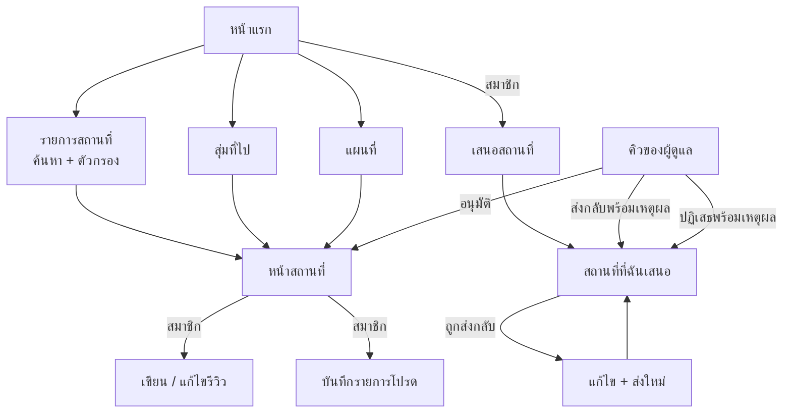
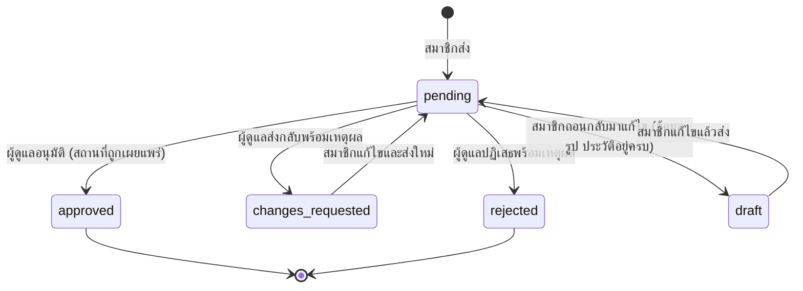
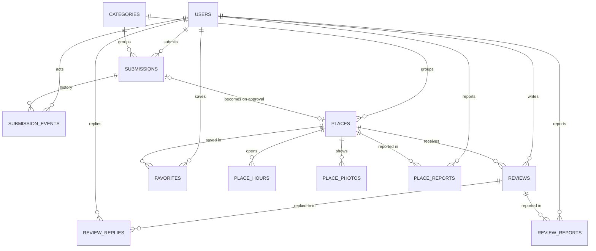

# การออกแบบ — วันนี้ไปไหนดี @ ลาดกระบัง

สถานะ: **ร่างเพื่อให้ทีมตรวจ** (พฤ. 12 พ.ย. 2569) ฐานข้อมูลในหัวข้อ 3
(ขั้นที่ 1) บัญชีผู้ใช้ (ขั้นที่ 2) การสำรวจสถานที่ (ขั้นที่ 3) และรีวิว รายการโปรด
การแจ้งข้อมูลผิด (ขั้นที่ 4) และการเสนอสถานที่พร้อมรูปและหมุด (ขั้นที่ 5) และเครื่องมือผู้ดูแล (ขั้นที่ 6) สร้างแล้ว
ส่วนที่เหลือยังเป็นแผน

เอกสารที่เกี่ยวข้อง: [PLAN.md](PLAN.md) (กำหนดการและขั้นตอน) ·
[ARCHITECTURE.md](ARCHITECTURE.md) (สร้างอย่างไร)

ชื่อตาราง คอลัมน์ ค่าสถานะ และ endpoint เขียนเป็นภาษาอังกฤษ เพราะเป็นชื่อเดียวกับในโค้ด

## 1. ผลิตภัณฑ์

คู่มือสถานที่ในเขตลาดกระบังภาษาไทย เขียนโดยคนที่อาศัยอยู่ที่นี่
ผู้เยี่ยมชมค้นหาและเลือกดูสถานที่ สมาชิกรีวิวสถานที่ บันทึกรายการโปรด
และเสนอสถานที่ใหม่ ผู้ดูแลตรวจทุกรายการที่เสนอก่อนเผยแพร่
ข้อมูลในเว็บจึงเชื่อถือได้

**ปัญหาที่แก้:** ข้อมูลร้านค้า คาเฟ่ และบริการในลาดกระบังกระจัดกระจาย
และมักล้าสมัย นักศึกษาและผู้ที่เพิ่งย้ายมาถามกันว่า "วันนี้ไปไหนดี"
แต่ไม่มีแหล่งเดียวที่เชื่อถือได้ให้ดู

### บทบาท

| บทบาท | ทำอะไรได้ |
|---|---|
| ผู้เยี่ยมชม (Visitor) | ค้นหา กรอง ดูสถานที่ รีวิว แผนที่ สุ่มที่ไป |
| สมาชิก (Member) | ทุกอย่างที่ผู้เยี่ยมชมทำได้ และเขียนรีวิว บันทึกรายการโปรด เสนอสถานที่ แจ้งข้อมูลผิด |
| ผู้ดูแล (Admin) | ทุกอย่างที่สมาชิกทำได้ และอนุมัติ / ส่งกลับ / ปฏิเสธรายการที่เสนอ แก้ไขและยกเลิกการเผยแพร่สถานที่ ลบรีวิว จัดการหมวดหมู่ ระงับและยกเลิกการระงับสมาชิก ดูบันทึกกิจกรรม |
| สมาชิกที่ถูกระงับ | เข้าสู่ระบบและอ่านได้ทุกอย่างเหมือนเดิม แต่เขียนอะไรไม่ได้ (รีวิว ตอบกลับ บันทึก แจ้ง เสนอสถานที่ แก้ชื่อ) ยกเว้นออกจากระบบ เปลี่ยนรหัสผ่าน และลบบัญชีตัวเอง เห็นแถบแจ้งเหตุผลและวันสิ้นสุดบนทุกหน้า |

ใครก็สมัครเป็นสมาชิกได้ ผู้ดูแลสร้างได้จาก command line เท่านั้น

### ฟีเจอร์ในเวอร์ชัน 1

- รายการสถานที่: ค้นหาด้วยข้อความ กรองตามหมวดหมู่และ "เปิดอยู่ตอนนี้" เรียงลำดับ แบ่งหน้า
- หน้าสถานที่: รายละเอียด เบอร์โทรและลิงก์ เวลาเปิดปิดรายสัปดาห์ รูปหลายรูป (ไม่เกิน 10 รูป เลื่อนดูได้) หมุดบนแผนที่ ปุ่มนำทาง รีวิว สถานที่ที่เกี่ยวข้อง
- หน้าแรก: สถานที่แนะนำ (ผู้ดูแลเลือก) คะแนนสูงสุด และปุ่ม **"สุ่มที่ไป"**
- แผนที่ของทุกสถานที่ที่มีพิกัด
- บัญชีผู้ใช้: สมัคร เข้าสู่ระบบ ออกจากระบบ โปรไฟล์ แก้ไขชื่อผู้ใช้ เปลี่ยนรหัสผ่าน
- รีวิว: สมาชิกหนึ่งคนต่อสถานที่หนึ่งแห่งรีวิวได้หนึ่งครั้ง 1–5 ดาว แก้ไข ลบ
- รายการโปรด: บันทึกและลบ
- แจ้งข้อมูลผิด: สมาชิกแจ้งว่าสถานที่ปิดกิจการ ย้าย หรือข้อมูลไม่ถูกต้อง ให้ผู้ดูแลตรวจ
- การเสนอสถานที่: เสนอพร้อมรูป (ไม่เกิน 5 รูป) และปักหมุดตำแหน่งบนแผนที่ ติดตามสถานะ แก้ไขและส่งใหม่เมื่อถูกส่งกลับ
- ผู้ดูแล: คิวรายการที่เสนอ เพิ่มสถานที่โดยตรง จัดการสถานที่ ดูแลรีวิว รายการแจ้งข้อมูลผิด หมวดหมู่

### ไม่อยู่ในเวอร์ชัน 1

รีเซ็ตรหัสผ่านทางอีเมล ยืนยันอีเมล รูปในรีวิว
สมาชิกแก้ไขสถานที่ที่เผยแพร่แล้ว หน้าจอภาษาอังกฤษ

## 2. ลำดับการใช้งาน

### ขั้นตอนการเสนอสถานที่

| สถานะ | สมาชิกทำได้ | ผู้ดูแลทำได้ |
|---|---|---|
| `draft` (ฉบับร่าง) | ดู แก้ไข ส่ง ลบถาวร | มองไม่เห็น (ไม่อยู่ในรายการ หน้าเดี่ยวตอบ 404) |
| `pending` (รอตรวจ) | ดู ถอนกลับเป็นฉบับร่าง ลบถาวร | อนุมัติ (ปรับตำแหน่งหมุดก่อนได้) ส่งกลับ ปฏิเสธ |
| `changes_requested` (ถูกส่งกลับให้แก้) | ดู แก้ไข ส่งใหม่ ลบถาวร | ดู |
| `approved` (อนุมัติแล้ว) | ดู เปิดหน้าสถานที่ที่เผยแพร่ | ดู |
| `rejected` (ปฏิเสธ) | ดูเหตุผล | ดู |

`rejected` เป็นสถานะที่เพิ่มจากสไลด์ข้อเสนอโครงงาน หากไม่มี ผู้ดูแลจะไม่มีทาง
ปิดรายการที่เป็นสแปมหรืออยู่นอกเขต

### สถานะของรีวิว

| สถานะ | ความหมาย | แสดงต่อสาธารณะ | ผู้เขียนทำได้ |
|---|---|---|---|
| `active` | ปกติ | ใช่ | แก้ไข ลบ |
| `deleted` | ผู้เขียนลบเอง | ไม่ | เขียนใหม่ได้ (ใช้แถวเดิม) |
| `removed` | ผู้ดูแลลบ พร้อมเหตุผล | ไม่ | ไม่มี |

ความเห็นตอบกลับรีวิว (`review_replies`) ใช้สถานะชุดเดียวกัน สมาชิกทุกคนตอบกลับรีวิวที่ `active`
ของสถานที่ที่เผยแพร่ได้ ตอบได้ชั้นเดียว (ตอบกลับความเห็นตอบกลับไม่ได้) ผู้เขียนแก้ไขและลบของตัวเองได้
ผู้ดูแลนำออกพร้อมเหตุผล ซึ่งผู้เขียนเห็นเพียงคนเดียว เมื่อรีวิวถูกซ่อน ความเห็นตอบกลับก็ถูกซ่อนไปด้วย
และเมื่อผู้เขียนรีวิวที่ลบไปแล้วเขียนใหม่ (ใช้แถวเดิม) ความเห็นตอบกลับเก่าจะเปลี่ยนเป็น `deleted`

## 3. ฐานข้อมูล

มีสิบสี่ตาราง (รายวิชากำหนดอย่างน้อยสามตาราง) เก้าตารางสร้างแล้วในขั้นที่ 1
คอลัมน์ `phone` และ `website_url` เพิ่มแล้วด้วย migration ในขั้นที่ 3
ส่วน `place_reports` เพิ่มแล้วในขั้นที่ 4 `review_replies` และ `place_photos` เพิ่มในขั้นที่ 7 `user_moderation_events` เพิ่มพร้อมระบบระงับสมาชิก ทุกตารางมี primary key เป็น `id`
ชนิด integer เว้นแต่ระบุ key อื่นไว้ `created_at` และ `updated_at` เป็น `timestamptz`

### users

| คอลัมน์ | ชนิด | กฎ |
|---|---|---|
| id | integer | Primary key |
| username | varchar(50) | 3–50 ตัวอักษร เป็นชื่อที่แสดง ซ้ำกันได้ |
| email | varchar(254) | ห้ามซ้ำ เก็บเป็นตัวพิมพ์เล็ก |
| password_hash | varchar(100) | bcrypt hash ไม่ถูกส่งออกจาก endpoint ใดเลย |
| role | enum | `member` (ค่าเริ่มต้น) หรือ `admin` |
| suspended_at, suspended_until, suspended_reason | timestamptz, timestamptz, varchar(500) | การระงับสมาชิก ว่างทั้งหมด = ไม่ถูกระงับ `suspended_at` กับ `suspended_reason` มีทั้งคู่หรือว่างทั้งคู่ `suspended_until` ว่าง = จนกว่าผู้ดูแลจะยกเลิก และต้องหลัง `suspended_at` (CHECK ทั้งสามข้อ) "ถูกระงับอยู่" คือมี `suspended_at` และ `suspended_until` ว่างหรือยังไม่ถึง ไม่มีงานล้างค่า การระงับที่หมดเวลาแล้วไม่ถูกนับเอง คอลัมน์ดิบไม่ถูกส่งออก ผู้ใช้เห็นเป็น `suspension: { reason, until }` |
| policy_accepted_at, policy_version | timestamptz, varchar(20) | เวลาและฉบับของนโยบายความเป็นส่วนตัวที่ยอมรับตอนสมัคร (PDPA) มีทั้งคู่หรือว่างทั้งคู่ ว่างสำหรับบัญชีเก่าและผู้ดูแลที่สร้างด้วยสคริปต์ |
| created_at, updated_at | timestamptz | |

### categories

| คอลัมน์ | ชนิด | กฎ |
|---|---|---|
| id | integer | Primary key |
| name | varchar(80) | ห้ามซ้ำ โดยไม่สนตัวพิมพ์ใหญ่ / เล็ก |
| created_at | timestamptz | |

### places

| คอลัมน์ | ชนิด | กฎ |
|---|---|---|
| id | integer | Primary key |
| category_id | integer | Foreign key → categories ลบหมวดหมู่ไม่ได้ขณะที่ยังถูกใช้อยู่ |
| name | varchar(200) | จำเป็น |
| description | text | จำเป็น ไม่เกิน 5000 ตัวอักษร |
| address | varchar(500) | จำเป็น |
| latitude, longitude | decimal(9,6) | มีทั้งคู่หรือว่างทั้งคู่ อยู่ในช่วงที่ถูกต้อง |
| image_path | varchar(500) | ไม่บังคับ path หรือ URL ของรูปหลัก (รูปอื่นอยู่ใน `place_photos`) |
| phone | varchar(30) | ไม่บังคับ เบอร์โทรของสถานที่ |
| website_url | varchar(500) | ไม่บังคับ เว็บไซต์ หน้า Facebook หรือ LINE ต้องขึ้นต้นด้วย `http://` หรือ `https://` |
| status | enum | `published` (เผยแพร่) หรือ `unpublished` (ไม่เผยแพร่) |
| featured_order | integer | ไม่บังคับ เป็นบวก ค่าน้อยแสดงก่อนในหน้าแรก |
| rating_avg | decimal(3,2) | ว่างเมื่อไม่มีรีวิวที่ใช้งานอยู่ |
| rating_count | integer | จำนวนรีวิวที่ใช้งานอยู่ ค่าเริ่มต้น 0 |
| created_by | integer | Foreign key → users (ผู้ดูแลที่เผยแพร่) ว่างสำหรับสถานที่ตั้งต้นที่โหลดจาก seed |
| created_at, updated_at | timestamptz | |

Index: `(status, category_id)`, `(status, rating_avg)`

### place_photos

รูปอื่นของสถานที่นอกจากรูปหลัก (`places.image_path`) ตามลำดับที่ผู้ดูแลจัด
สถานที่หนึ่งแห่งมีรูปได้ไม่เกิน 10 รูป (รูปหลัก 1 + รูปอื่น 9 ตรวจในแอปภายใต้ล็อกแถวสถานที่)

| คอลัมน์ | ชนิด | กฎ |
|---|---|---|
| id | integer | Primary key |
| place_id | integer | Foreign key → places (ลบสถานที่แล้วรูปถูกลบตาม) |
| image_path | varchar(500) | จำเป็น ไม่ว่างเปล่า (CHECK) |
| position | smallint | 0 ขึ้นไป (CHECK) ต่อเนื่องกันตั้งแต่ 0 |
| created_at | timestamptz | |

Unique: `(place_id, position)` ไฟล์รูปหนึ่งไฟล์อาจถูกใช้ร่วมกันระหว่างคำขอที่อนุมัติแล้วกับสถานที่ และประวัติของคำขอ (snapshot) ยังแสดงรูปเดิม รูปที่ถูกแทนที่จึงยังเก็บไว้ตราบใดที่ประวัติอ้างถึง
จึงลบไฟล์เฉพาะเมื่อไม่มีแถวใดอ้างถึงแล้ว (`models/photoUsage.js`)

### place_hours

| คอลัมน์ | ชนิด | กฎ |
|---|---|---|
| place_id | integer | Foreign key → places เป็นส่วนหนึ่งของ primary key |
| weekday | smallint | 0 (อาทิตย์) ถึง 6 (เสาร์) เป็นส่วนหนึ่งของ primary key |
| state | enum | `open` (เปิด), `closed` (ปิด) หรือ `unknown` (ไม่ทราบ) |
| opens_at, closes_at | time | จำเป็นเมื่อ `open` ว่างในกรณีอื่น |
| closes_next_day | boolean | true เมื่อเวลาปิดเลยเที่ยงคืน ระบบคิดให้เองจากเวลา: เวลาปิดไม่หลังเวลาเปิด (เช่น 08:00–00:00, 18:00–02:00, 00:00–00:00 = 24 ชั่วโมง) ค่า `closesNextDay` ที่ส่งมาทาง API ไม่ถูกใช้ |

ทุกสถานที่มีเจ็ดแถวพอดี และเขียนพร้อมกันทั้งเจ็ดแถว

### reviews

| คอลัมน์ | ชนิด | กฎ |
|---|---|---|
| id | integer | Primary key |
| user_id | integer | Foreign key → users |
| place_id | integer | Foreign key → places |
| rating | smallint | 1 ถึง 5 |
| comment | varchar(2000) | ไม่บังคับ |
| status | enum | `active`, `deleted` หรือ `removed` |
| removed_by | integer | Foreign key → users มีค่าเฉพาะเมื่อ `removed` |
| removed_reason | varchar(500) | จำเป็นเมื่อ `removed` |
| created_at, updated_at | timestamptz | |

Unique: `(user_id, place_id)` Index: `(place_id, status)`

### review_replies

| คอลัมน์ | ชนิด | กฎ |
|---|---|---|
| id | integer | Primary key |
| review_id | integer | Foreign key → reviews |
| user_id | integer | Foreign key → users |
| body | varchar(1000) | จำเป็น ไม่ว่างเปล่า (CHECK) |
| status | enum | `active`, `deleted` หรือ `removed` (ชนิดเดียวกับ reviews) |
| removed_by | integer | Foreign key → users มีค่าเฉพาะเมื่อ `removed` (CHECK) |
| removed_reason | varchar(500) | จำเป็นเมื่อ `removed` |
| created_at, updated_at | timestamptz | |

Index: `(review_id, status, created_at)`

### favorites

| คอลัมน์ | ชนิด | กฎ |
|---|---|---|
| user_id | integer | Foreign key → users เป็นส่วนหนึ่งของ primary key |
| place_id | integer | Foreign key → places เป็นส่วนหนึ่งของ primary key |
| created_at | timestamptz | |

### submissions

| คอลัมน์ | ชนิด | กฎ |
|---|---|---|
| id | integer | Primary key |
| user_id | integer | Foreign key → users (สมาชิกที่เสนอ) |
| category_id | integer | Foreign key → categories |
| name, description, address, image_path, phone, website_url | | ชนิดและกฎเหมือน `places` |
| latitude, longitude | decimal(9,6) | **จำเป็น** สมาชิกต้องปักหมุดบนแผนที่ และต้องอยู่ในบริเวณลาดกระบัง |
| extra_image_paths | varchar(500)[] | รูปที่ 2–5 ของคำขอ (`image_path` คือรูปแรก) ไม่เกิน 4 รายการ และมีได้เฉพาะเมื่อมี `image_path` (CHECK) |
| hours | jsonb | เจ็ดรายการ หนึ่งรายการต่อหนึ่งวัน |
| status | enum | `draft`, `pending`, `changes_requested`, `approved` หรือ `rejected` |
| version | integer | เริ่มที่ 1 เพิ่มขึ้นทุกครั้งที่มีการเปลี่ยนแปลง |
| review_note | varchar(1000) | เหตุผลล่าสุดของผู้ดูแล |
| place_id | integer | Foreign key → places ห้ามซ้ำ มีค่าเฉพาะเมื่อ `approved` |
| created_at, updated_at | timestamptz | |

Index: `(status, created_at)`, `(user_id)`

### submission_events

| คอลัมน์ | ชนิด | กฎ |
|---|---|---|
| id | integer | Primary key |
| submission_id | integer | Foreign key → submissions |
| actor_id | integer | Foreign key → users |
| action | enum | `submitted`, `edited`, `resubmitted`, `withdrawn`, `returned`, `approved`, `rejected` |
| note | varchar(1000) | เหตุผล สำหรับ `returned` และ `rejected` และข้อความว่าผู้ดูแลย้ายหมุด สำหรับ `approved` |
| snapshot | jsonb | เนื้อหาของรายการที่เสนอ ณ ขณะนั้น |
| created_at | timestamptz | |

แถวในตารางนี้มีแต่เพิ่ม ไม่มีการแก้ไข

### user_moderation_events

| คอลัมน์ | ชนิด | กฎ |
|---|---|---|
| id | integer | Primary key |
| user_id | integer | Foreign key → users (สมาชิกที่ถูกระงับ) |
| actor_id | integer | Foreign key → users (ผู้ดูแลที่ทำ) |
| action | enum | `suspended`, `unsuspended` |
| note | varchar(500) | เหตุผลของการระงับ หรือหมายเหตุตอนยกเลิก (ไม่บังคับ) |
| until | timestamptz | วันสิ้นสุดของการระงับครั้งนั้น ว่าง = จนกว่าจะยกเลิก |
| created_at | timestamptz | |

แถวในตารางนี้มีแต่เพิ่ม ไม่มีการแก้ไข ประวัติจึงยังอยู่หลังยกเลิกการระงับ มี index ที่ `(user_id, created_at)`

### place_reports

| คอลัมน์ | ชนิด | กฎ |
|---|---|---|
| id | integer | Primary key |
| place_id | integer | Foreign key → places |
| user_id | integer | Foreign key → users (สมาชิกที่แจ้ง) |
| reason | enum | `closed` (ปิดกิจการ), `moved` (ย้ายที่), `wrong_info` (ข้อมูลผิด) หรือ `other` (อื่น ๆ) |
| details | varchar(1000) | คำอธิบาย จำเป็นเมื่อเหตุผลเป็น `other` |
| status | enum | `open` (รอตรวจ), `resolved` (แก้ไขแล้ว) หรือ `dismissed` (ไม่ดำเนินการ) |
| resolved_by | integer | Foreign key → users มีค่าเมื่อไม่ใช่ `open` |
| created_at, resolved_at | timestamptz | |

Index: `(status, created_at)` สมาชิกหนึ่งคนมีรายงานที่ยัง `open` ได้หนึ่งรายการต่อสถานที่

### review_reports

สมาชิกรายงานรีวิวของคนอื่น (สแปม ไม่สุภาพ ข้อมูลเท็จ)

| คอลัมน์ | ชนิด | กฎ |
|---|---|---|
| id | integer | Primary key |
| review_id | integer | Foreign key → reviews (ลบรีวิวจริงแล้วรายงานลบตาม) |
| user_id | integer | Foreign key → users (สมาชิกที่รายงาน) |
| reason | enum | `spam` (สแปมหรือโฆษณา), `offensive` (ไม่สุภาพหรือสร้างความเกลียดชัง), `false_info` (ข้อมูลเท็จหรือทำให้เข้าใจผิด) หรือ `other` (อื่น ๆ) |
| details | varchar(1000) | คำอธิบาย ห้ามเป็นข้อความว่าง จำเป็นเมื่อเหตุผลเป็น `other` |
| status | enum | ใช้ `report_status` ร่วมกับ place_reports: `open`, `resolved` (รีวิวถูกนำออก) หรือ `dismissed` (ไม่ดำเนินการ) |
| resolved_by | integer | Foreign key → users มีค่าเมื่อไม่ใช่ `open` (CHECK) |
| created_at, resolved_at | timestamptz | |

Index: `(status, created_at)` สมาชิกหนึ่งคนมีรายงานที่ยัง `open` ได้หนึ่งรายการต่อรีวิว
(partial unique index) รายงานรีวิวของตัวเองไม่ได้ (ตรวจในโค้ด) เมื่อผู้ดูแลนำรีวิวออก
รายงานที่ยัง `open` ของรีวิวนั้นกลายเป็น `resolved` ในธุรกรรมเดียวกัน

### sessions

ตารางนี้เป็นของตัวจัดเก็บ session (`connect-pg-simple` เพิ่มในขั้นที่ 2)
ซึ่งอ่านและเขียนตารางนี้โดยตรง

| คอลัมน์ | ชนิด | กฎ |
|---|---|---|
| sid | varchar | Primary key คือ session ID |
| sess | json | ข้อมูล session: user ID ของผู้ที่เข้าสู่ระบบ และ CSRF token |
| expire | timestamp | เวลาที่ session หมดอายุ มี index |

### เหตุผลในการออกแบบ

- **รายการที่เสนอแยกเป็นตารางของตัวเอง ไม่ใช่สถานะหนึ่งใน `places`**
  การค้นหาสาธารณะอ่านเฉพาะ `places` ข้อเสนอที่ยังไม่อนุมัติหรือถูกปฏิเสธ
  จึงไม่มีทางหลุดไปอยู่ในผลค้นหาเพราะมีคนลืมใส่เงื่อนไข `WHERE`
- **ลบแบบ soft delete ทุกที่** สถานที่ถูกยกเลิกการเผยแพร่ และรีวิวถูกทำเครื่องหมาย
  `deleted` หรือ `removed` สิ่งที่สมาชิกเขียนไม่ถูกทำลาย และสมาชิกเลี่ยงการตรวจ
  ด้วยการลบรีวิวที่ถูกผู้ดูแลลบแล้วเขียนใหม่ไม่ได้ เพราะแถว (ผู้ใช้, สถานที่) ยังอยู่
- **เวลาเปิดปิดเก็บเป็นแถวสำหรับสถานที่ และเป็น JSON สำหรับรายการที่เสนอ**
  "เปิดอยู่ตอนนี้" ต้องกรองใน SQL สถานที่จึงต้องมีแถวจริง รายการที่เสนอเป็นแค่
  ข้อเสนอที่ถูกคัดลอกเมื่ออนุมัติ JSON จึงเพียงพอ
- **`rating_avg` และ `rating_count` เก็บไว้ในสถานที่** คำนวณใหม่จากตาราง reviews
  (ไม่ใช้การบวกเพิ่ม) ภายใน transaction เดียวกับการเปลี่ยนแปลงรีวิวทุกครั้ง
  ค่าจึงไม่คลาดเคลื่อน และการเรียงตามคะแนนเป็นแค่ query ธรรมดาที่ใช้ index
- **"เปิดอยู่ตอนนี้" คิดที่เดียว ใช้สองทาง** กฎเดียวกันใน `utils/openingHours.js`
  ให้ทั้งป้ายสถานะบนการ์ด และตัวกรองในฐานข้อมูล (จึงใช้ร่วมกับการค้นหา การเรียง
  และการแบ่งหน้าได้) แถวที่ปิดหลังเที่ยงคืนครอบคลุมช่วงเช้ามืดของวันถัดไปด้วย
  และการทดสอบตรวจว่าสองทางนี้ให้ผลตรงกันเสมอ
- **การค้นหา escape อักขระ `%` และ `_` เอง** เพราะ Prisma ไม่ทำให้ และคำค้นที่เป็น
  ส่วนหนึ่งของ "เขตลาดกระบัง กรุงเทพมหานคร" (เช่น "ตลาด") จะไม่ค้นในที่อยู่
  ไม่เช่นนั้นจะตรงกับทุกสถานที่
- **เวลามีสองแบบ** เวลาที่เกิดเหตุการณ์เป็น `timestamptz` แบบ UTC
  เวลาเปิดปิดเป็นเวลาตามนาฬิกาในเขตเวลากรุงเทพฯ เพราะ "เปิด 09:00"
  ไม่ขึ้นกับว่าเซิร์ฟเวอร์อยู่ที่ไหน
- **สมาชิกปักหมุด ผู้ดูแลปรับได้** ฟอร์มเสนอสถานที่มีแผนที่ให้แตะหรือลากหมุด
  และส่งไม่ได้ถ้าไม่มีหมุด ผู้ดูแลลากหมุดให้ตรงได้ทั้งตอนตรวจและหลังเผยแพร่
  การย้ายหมุดตอนอนุมัติถูกบันทึกในประวัติ สมาชิกจึงเห็นว่าหมุดถูกย้าย
  แผนที่ต้องใช้ JavaScript ฟอร์มจึงแสดงช่องละติจูดและลองจิจูดเป็นช่องธรรมดาด้วย
- **ทุกการเปลี่ยนรีวิวล็อกแถวของสถานที่ก่อน** แล้วคำนวณคะแนนเฉลี่ยใหม่ใน transaction เดียวกัน
  สมาชิกหลายคนรีวิวสถานที่เดียวกันพร้อมกันจึงต้องรอกัน และค่าเฉลี่ยไม่มีวันตกหล่น
  (มีการทดสอบที่ส่งรีวิวหกรายการพร้อมกัน)
- **ปุ่มบันทึกสถานที่ใช้ได้ทั้งมีและไม่มี JavaScript** มี JavaScript จะเรียก
  `PUT`/`DELETE /api/v1/me/favorites/:placeId` โดยไม่โหลดหน้าใหม่ ไม่มีก็ส่งฟอร์มตามปกติ
  การ์ดสถานที่ (หน้าแรก สำรวจสถานที่ สถานที่ที่เกี่ยวข้อง) มีปุ่มหัวใจสำหรับสมาชิกแบบเดียวกัน
  ส่ง `next` เป็นหน้าปัจจุบันพร้อม query (รับเฉพาะ path ภายในเว็บ) สถานะบันทึกของทั้งหน้าได้จาก
  `favorite.savedPlaceIds` ด้วยคำสั่งเดียว หน้า "ที่บันทึกไว้" ใช้ปุ่ม "นำออกจากรายการ" แทนหัวใจ
- **สมาชิกแก้ไขหรือลบรีวิวของตัวเองได้ในหน้าสถานที่** รีวิวของตัวเองแสดงบนสุดและไม่ซ้ำในรายการ
  ฟอร์ม `POST /reviews/:id/edit` และ `/reviews/:id/delete` ส่ง `next` ได้ ระบบกลับไปที่ `next`
  เฉพาะเมื่อเป็น `/places/<id>` หรือ `/places/<id>#reviews` นอกนั้นกลับไป `/me/reviews`
  ช่องคะแนนเป็นปุ่มวิทยุรูปดาว (`partials/star-input.ejs`) ใช้แป้นพิมพ์ได้และไม่ต้องมี JavaScript
- **ผู้ดูแลอยู่หน้าเดิมหลังบันทึก** บันทึกหรือเพิ่มสถานที่แล้วกลับไปที่ `/admin/places/:id/edit`
  ปุ่มเผยแพร่ / ซ่อนในรายการส่งฟิลด์ `back` (path `/admin/places` พร้อม query เท่านั้น ค่าอื่นใช้ `/admin/places`)
  จึงกลับไปหน้าเดิมพร้อมตัวกรอง
- **ฟอร์มที่มีรูปตรวจ CSRF หลังอ่านไฟล์** ฟอร์มแบบ multipart อ่าน `_csrf` ได้หลังแยกไฟล์แล้ว
  จึงมีรายการ route ที่รับรูปไว้ที่เดียวใน `middleware/csrf.js` route เหล่านั้นตรวจ token ทันทีหลัง
  อัปโหลด ส่วนคำขอ multipart ไปยัง route อื่นถูกตรวจตามปกติและถูกปฏิเสธ
- **รูปถูกเก็บหลังข้อมูลอื่นผ่านการตรวจเท่านั้น** และถูกลบทิ้งถ้าการบันทึกลงฐานข้อมูลล้มเหลว
  แก้ไขคำขอพร้อมรูปใหม่จะลบไฟล์รูปเดิมหลังบันทึกสำเร็จ จึงไม่มีไฟล์ค้าง
- **การตัดสินคำขอล็อกแถวก่อนเสมอ** อนุมัติ ส่งกลับ และปฏิเสธ ล็อกแถวของคำขอ (`FOR UPDATE`)
  แล้วตรวจสถานะและ version ผู้ดูแลสองคนที่กดพร้อมกันจึงต้องรอกัน คนแรกสำเร็จ คนที่สองได้ 409
  การอนุมัติสร้างสถานที่ แถวเวลาเปิดปิด 7 แถว เปลี่ยนสถานะคำขอ และบันทึกประวัติใน transaction เดียว
- **`PATCH /admin/places/:id` มีสองแบบ** ส่งเฉพาะ `status` / `featuredOrder` เพื่อเผยแพร่ ซ่อน หรือจัดลำดับแนะนำ
  หรือส่งเนื้อหาครบทั้งชุดเพื่อแก้ไขและแทนที่เวลาเปิดปิดทั้งเจ็ดแถว หมุดของสถานที่ที่ผู้ดูแลแก้ไม่บังคับ
  (สถานที่ตั้งต้นบางแห่งยังไม่มีหมุด) รูปเดิมถูกลบเมื่อไม่มีคำขอหรือสถานที่อื่นใช้ไฟล์เดียวกันแล้วเท่านั้น
- **ปุ่มนำทางไม่ต้องใช้ API key** เป็นลิงก์ธรรมดาที่เปิด Google Maps พร้อมพิกัด
  ของหมุด แสดงเฉพาะสถานที่ที่มีหมุด
- **ผู้ดูแลเพิ่มสถานที่ได้โดยตรง** ไม่ต้องเสนอในฐานะสมาชิกแล้วอนุมัติเอง
  สถานที่ที่เพิ่มแบบนี้ไม่มีรายการที่เสนอคู่กัน
- **การแจ้งข้อมูลผิดไม่แก้ไขสถานที่เอง** เป็นเพียงข้อความถึงผู้ดูแล ซึ่งเป็นผู้แก้ไข
  หรือยกเลิกการเผยแพร่สถานที่ แล้วปิดรายงาน
- กฎที่ Prisma schema เขียนไม่ได้ (ช่วงคะแนน คู่พิกัด ชื่อห้ามซ้ำโดยไม่สนตัวพิมพ์)
  เพิ่มเป็น `CHECK` constraint และ index ของ SQL ในไฟล์ migration

### Transaction

| การทำงาน | สิ่งที่ต้องเกิดพร้อมกัน |
|---|---|
| อนุมัติรายการที่เสนอ | ทำเครื่องหมายว่าอนุมัติ (เฉพาะเมื่อยังเป็น `pending` ที่ version ที่ผู้ดูแลเห็น) → สร้างสถานที่ (ใช้ตำแหน่งหมุดที่ผู้ดูแลปรับแล้ว ถ้ามี) → สร้างแถวเวลาเปิดปิด 7 แถว → บันทึกประวัติ รวมถึงการย้ายหมุด หากขั้นใดล้มเหลว ย้อนกลับทั้งหมด |
| ส่งกลับ / ปฏิเสธ / แก้ไข / ส่งใหม่ | เปลี่ยนรายการที่เสนอ (ตรวจ version แบบเดียวกัน) → บันทึกประวัติ |
| สร้าง / แก้ไข / ลบ / ผู้ดูแลลบรีวิว | เปลี่ยนรีวิว → คำนวณคะแนนของสถานที่ใหม่ |
| ผู้ดูแลแก้เวลาเปิดปิดของสถานที่ | แทนที่ทั้งเจ็ดแถวพร้อมกัน |

## 4. API

ทุก path ขึ้นต้นด้วย `/api/v1` คำขอและคำตอบเป็น JSON ยกเว้น endpoint
การเสนอสถานที่ที่แนบรูป ซึ่งใช้ `multipart/form-data`

- สำเร็จ: `{ "data": ... }` รายการเพิ่ม `"meta": { "page", "pageSize", "total" }`
- ผิดพลาด: `{ "error": { "code", "message", "details" } }`
- สถานะการเข้าสู่ระบบอยู่ในคุกกี้ session คำขอที่เปลี่ยนข้อมูลต้องส่ง
  CSRF token ใน header `X-CSRF-Token` ด้วย

### สาธารณะ

| Method | Path | คำอธิบาย | Status |
|---|---|---|---|
| GET | `/auth/csrf` | ขอ CSRF token | 200 |
| POST | `/auth/register` | สมัครสมาชิก บทบาทเป็น `member` เสมอ ต้องส่ง `acceptPolicy: true` (ยอมรับนโยบายความเป็นส่วนตัว) ไม่ส่งตอบ 400 (`field: acceptPolicy`) ส่ง `confirmPassword` ได้ (ไม่บังคับ) ถ้าส่งต้องตรงกับ `password` ไม่ตรงตอบ 400 (`field: confirmPassword`) | 201 |
| POST | `/auth/login` | เข้าสู่ระบบ เริ่ม session ใหม่ | 200 |
| GET | `/categories` | หมวดหมู่พร้อมจำนวนสถานที่ | 200 |
| GET | `/places` | ค้นหาและกรองสถานที่ที่เผยแพร่ | 200 |
| GET | `/places/map` | สถานที่ที่มีพิกัด (`id`, `name`, `latitude`, `longitude`, `imagePath` รูปหลักที่แสดงใน popup ของหมุด, `category`, `openStatus`) | 200 |
| GET | `/places/random` | สุ่มสถานที่หนึ่งแห่ง (กรองด้วยคำค้น `q` หมวดหมู่ / เปิดอยู่ตอนนี้ได้) | 200 |
| GET | `/places/:id` | รายละเอียดสถานที่และเวลาเปิดปิด พร้อม `gallery` (path ของทุกรูป รูปหลักก่อน) รายการรีวิวเรียงและกรองได้ด้วย `reviewSort` และ `reviewRating` | 200 |
| GET | `/places/:id/related` | สถานที่ในหมวดหมู่เดียวกัน | 200 |
| GET | `/places/:id/reviews` | รีวิวที่ใช้งานอยู่ของสถานที่ แต่ละรีวิวมี `replies` (ความเห็นตอบกลับที่ `active` เก่าสุดก่อน ไม่เกิน 50 รายการ และของผู้ขอเองที่ถูกนำออกพร้อมเหตุผล) เรียงด้วย `sort` (`newest` ค่าเริ่มต้น, `oldest`, `highest`, `lowest`) และกรองด้วย `rating` (1–5) ค่าที่ไม่รู้จักใช้ค่าเริ่มต้น | 200 |
| GET | `/recommendations` | สถานที่แนะนำ (ไม่เกิน 5 แห่ง ตามลำดับที่ผู้ดูแลตั้ง) และคะแนนสูงสุด | 200 |

พารามิเตอร์ของ `GET /places`: `q` (ข้อความ), `categoryId`, `openNow` (`true`),
`sort` (`name`, `rating`, `newest`), `page`, `pageSize`

- ค่าที่ไม่ถูกต้อง (เช่น `page=0` หรือ `pageSize=1000`) ได้ 400 `VALIDATION_ERROR` จาก API
  ส่วนหน้าเว็บจะใช้ค่าเริ่มต้นแทน ไม่ขึ้นหน้าข้อผิดพลาด
- หน้าที่เกินหน้าสุดท้าย: API ตอบรายการว่างพร้อม `meta` ส่วนหน้าเว็บแสดงหน้าสุดท้าย
- ทุกสถานที่ในคำตอบมี `openStatus`: `open` (พร้อม `closesAt`), `closed` (พร้อม `opensAt`
  ถ้าทราบ) หรือ `unknown` คิดตามเวลาประเทศไทย
- `GET /places/:id/related` ตอบ `sameCategory` และ `nearby` (ภายใน 2 กม. เรียงจากใกล้ไปไกล
  พร้อม `distanceKm`)

### สมาชิก

| Method | Path | คำอธิบาย | Status |
|---|---|---|---|
| POST | `/auth/logout` | ออกจากระบบ ทำลาย session | 204 |
| GET | `/me` | บัญชีของตัวเอง | 200 |
| PATCH | `/me` | แก้ไขชื่อผู้ใช้ | 200 |
| PUT | `/me/password` | เปลี่ยนรหัสผ่าน ต้องส่งรหัสผ่านเดิม และ session อื่นของบัญชีถูกยกเลิก ส่ง `confirmNewPassword` ได้ (ไม่บังคับ) ถ้าส่งต้องตรงกับ `newPassword` ไม่ตรงตอบ 400 (`field: confirmNewPassword`) | 204 |
| POST | `/me/logout-others` | ออกจากระบบอุปกรณ์อื่นทั้งหมด ต้องส่ง `password` อุปกรณ์ที่ส่งคำขอยังเข้าสู่ระบบอยู่ (ได้ session ใหม่) session อื่นของบัญชีถูกยกเลิก รหัสผ่านผิดตอบ 400 และนับรวมกับตัวจำกัดการเดารหัสผ่านเดียวกับการเปลี่ยนรหัสผ่าน | 204 |
| DELETE | `/me` | ลบบัญชีของตัวเอง ต้องส่ง `password` รีวิวและความเห็นตอบกลับถูกลบ (สถานะ deleted) คะแนนสถานที่คำนวณใหม่ ลบที่บันทึกไว้และคำขอที่ยังไม่ตัดสิน ข้อมูลส่วนตัวในแถวผู้ใช้ถูกแทนที่ (ชื่อเป็น "ผู้ใช้ที่ลบบัญชี" อีเมลนำไปสมัครใหม่ได้) ทุก session สิ้นสุด รหัสผ่านผิดตอบ 400 (`field: password`) ผู้ดูแลตอบ 409 | 204 |
| POST | `/places/:id/reviews` | เขียนรีวิว | 201 |
| GET | `/me/reviews` | รีวิวของตัวเอง | 200 |
| PATCH | `/reviews/:id` | แก้ไขรีวิวของตัวเอง เฉพาะฟิลด์ที่ส่งมา (`comment: null` คือลบความเห็น) | 200 |
| DELETE | `/reviews/:id` | ลบรีวิวของตัวเอง (soft) | 204 |
| POST | `/reviews/:id/reports` | รายงานรีวิวของคนอื่น body: `reason` (`spam` `offensive` `false_info` `other`) และ `details` (ไม่บังคับ ไม่เกิน 1000 ตัวอักษร ต้องมีเมื่อเป็น `other`) รีวิวที่ซ่อนอยู่หรือของสถานที่ที่ไม่เผยแพร่ตอบ 404 รีวิวของตัวเองตอบ 409 `INVALID_STATE` รายงานซ้ำที่ยังเปิดอยู่ตอบ 409 `REPORT_EXISTS` | 201 |
| POST | `/reviews/:id/replies` | ตอบกลับรีวิว (รีวิวที่ซ่อนอยู่หรือไม่มีตอบ 404) หนึ่งรีวิวมีความเห็นตอบกลับได้ไม่เกิน 50 รายการ รายการที่ 51 ตอบ 409 `INVALID_STATE` | 201 |
| PATCH | `/replies/:id` | แก้ไขความเห็นตอบกลับของตัวเอง (`body`) | 200 |
| DELETE | `/replies/:id` | ลบความเห็นตอบกลับของตัวเอง (soft) | 204 |
| GET | `/me/favorites` | สถานที่ที่บันทึกไว้และยังเผยแพร่อยู่ | 200 |
| PUT | `/me/favorites/:placeId` | บันทึกสถานที่ (ทำซ้ำได้ปลอดภัย) | 201 / 200 |
| DELETE | `/me/favorites/:placeId` | ลบสถานที่ที่บันทึกไว้ | 204 |
| POST | `/places/:id/reports` | แจ้งข้อมูลผิดของสถานที่ | 201 |
| POST | `/submissions` | เสนอสถานที่ ต้องมีพิกัดของหมุด แนบรูปได้ไม่เกิน 5 รูปในช่อง `photos` (หรือช่อง `photo` เดิม 1 รูป) รูปแรกเป็นรูปหลัก ผลลัพธ์มี `imagePath` และ `extraImagePaths` เกิน 5 รูปตอบ 400 ไฟล์ใดเสียตอบ 415 (ข้อความขึ้นต้น "รูปที่ n:") และไม่เก็บรูปใดเลย | 201 |
| GET | `/me/submissions` | รายการที่ตัวเองเสนอและสถานะ | 200 |
| GET | `/me/submissions/:id` | รายการที่เสนอหนึ่งรายการ พร้อมประวัติและเหตุผลของผู้ดูแล | 200 |
| PATCH | `/me/submissions/:id` | แก้ไขฉบับร่างหรือรายการที่ถูกส่งกลับ ถ้าไม่ส่ง `photoOrder`: แนบรูปใหม่ รูปเดิมทั้งหมดถูกแทนที่ ไม่แนบ รูปเดิมคงอยู่ ถ้าส่ง `photoOrder` (เช่น `new:1,keep:0,new:0` โดย `keep:n` คือรูปเดิมลำดับที่ n และ `new:n` คือไฟล์ใหม่ลำดับที่ n) รูปจะเป็นตามลำดับนั้น รูปแรกเป็นรูปหลัก รูปเดิมที่ไม่อยู่ในรายการถูกนำออก ค่าว่างคือไม่มีรูป ลำดับผิด ไฟล์ใหม่ที่ไม่อยู่ในรายการ หรือรวมเกิน 5 รูปตอบ 400 | 200 |
| POST | `/me/submissions/:id/resubmit` | ส่งฉบับร่างหรือคำขอที่ถูกส่งกลับไปให้ตรวจ (กลายเป็น `pending`) | 200 |
| POST | `/me/submissions/:id/withdraw` | ถอนคำขอที่รอตรวจสอบกลับมาเป็นฉบับร่าง `draft` ต้องส่ง `version` ข้อมูล รูป และประวัติอยู่ครบ บันทึกเหตุการณ์ `withdrawn` สถานะอื่นตอบ 409 `INVALID_STATE` | 200 |
| DELETE | `/me/submissions/:id` | ลบคำขอถาวร (ฉบับร่าง รอตรวจสอบ หรือรอแก้ไข) ต้องส่ง `version` ลบคำขอ ประวัติ และรูปที่ไม่มีที่อื่นใช้ คำขอที่ตัดสินแล้วตอบ 409 `INVALID_STATE` ฉบับเก่าตอบ 409 `STALE_VERSION` | 204 |

### ผู้ดูแล

| Method | Path | คำอธิบาย | Status |
|---|---|---|---|
| GET | `/admin/submissions` | รายการที่เสนอทั้งหมด กรองตามสถานะได้ | 200 |
| GET | `/admin/submissions/:id` | รายละเอียด ประวัติ และ `possibleDuplicates` (ไม่เกิน 5 รายการ: สถานที่ที่ชื่อคล้ายกันหรือหมุดห่างไม่เกิน 150 ม. แต่ละรายการมี `matchedBy` และ `distanceMeters` มีค่าเฉพาะคำขอ `pending` / `changes_requested`) | 200 |
| POST | `/admin/submissions/:id/approve` | อนุมัติและเผยแพร่สถานที่ ส่งพิกัดที่แก้ไขแล้วมาด้วยได้ | 201 |
| POST | `/admin/submissions/:id/return` | ส่งกลับพร้อมเหตุผล | 200 |
| POST | `/admin/submissions/:id/reject` | ปิดรายการพร้อมเหตุผล | 200 |
| POST | `/admin/places` | เพิ่มสถานที่โดยตรง พร้อมเวลาเปิดปิด | 201 |
| GET | `/admin/places` | สถานที่ทั้งหมด รวมที่ไม่เผยแพร่ กรองด้วย `q`, `status` และ `missing` (`pin`, `hours`, `photo` = ยังไม่มีข้อมูลนั้น) | 200 |
| GET | `/admin/places/:id` | สถานที่หนึ่งแห่งแบบครบทุกฟิลด์ สำหรับแก้ไข รวม `photos` (รูปอื่นนอกจากรูปหลัก) | 200 |
| PATCH | `/admin/places/:id` | แก้ไข เผยแพร่ / ยกเลิกการเผยแพร่ ตั้งลำดับแนะนำ ถ้าส่งฟิลด์เนื้อหาต้องส่งเวลาเปิดปิดครบ 7 วันด้วย (`hours` เป็นอาร์เรย์ หรือสตริง JSON เมื่อส่งแบบ multipart หรือฟิลด์ `state0`–`state6`) ไม่ส่งตอบ 400 (`field: hours`) ส่งเฉพาะ `status` / `featuredOrder` ไม่ต้องส่ง | 200 |
| DELETE | `/admin/places/:id` | ลบสถานที่ถาวร (ทางเลือกที่สองนอกจากการซ่อน) ได้เฉพาะสถานที่ที่ไม่มีรีวิวเลยในทุกสถานะ มิฉะนั้นตอบ 409 `INVALID_STATE` เวลาเปิดปิด รูป ที่บันทึกไว้ รายการแจ้ง และคำขอที่สร้างสถานที่นี้ถูกลบไปด้วย | 204 |
| GET | `/admin/featured` | สถานที่ "ทีมงานชวนไป" บนหน้าแรกตามลำดับ (รวมที่ซ่อนอยู่) `meta.limit` คือจำนวนที่แสดงบนหน้าแรก (5) | 200 |
| PUT | `/admin/featured` | ตั้งรายการแนะนำทั้งชุด `{ placeIds: [3, 8, 1] }` ตามลำดับ (ตัวแรกเป็นการ์ดใหญ่) ระบบเรียงเลข `featured_order` ใหม่เป็น 1, 2, 3 ... สถานที่ที่ไม่อยู่ในรายการถูกนำออก เกิน 5 แห่ง ซ้ำ หรือเพิ่มสถานที่ที่ซ่อนอยู่ตอบ 400 ไม่พบสถานที่ตอบ 404 | 200 |
| POST | `/admin/places/:id/photos` | เพิ่มรูปหลายรูป (multipart ช่อง `photos` ครั้งละไม่เกิน 9) ถ้ายังไม่มีรูปหลัก รูปแรกเป็นรูปหลัก รวมเกิน 10 รูปตอบ 400 ผลลัพธ์ `{ cover, photos: [{ id, imagePath, position }] }` | 201 |
| POST | `/admin/places/:id/photos/:photoId/cover` | ตั้งรูปนี้เป็นรูปหลัก (สลับกับรูปหลักเดิม) | 200 |
| POST | `/admin/places/:id/photos/:photoId/move` | เลื่อนรูป `{ direction: "up" \| "down" }` สุดทางแล้วไม่เปลี่ยนอะไร | 200 |
| DELETE | `/admin/places/:id/photos/:photoId` | ลบรูป (ไฟล์ถูกลบเมื่อไม่มีที่ใช้แล้ว) | 204 |
| DELETE | `/admin/places/:id/cover` | ลบรูปหลัก รูปแรกในแกลเลอรีขึ้นเป็นรูปหลักแทน | 200 |
| PUT | `/admin/places/:id/cover/template` | ใช้ภาพประกอบสำเร็จรูปเป็นรูปหลัก `{ template: "cafe" | "dining" | "market" | "lodging" | "temple" | "park" | "nature" | "canal" | "library" | "health" | "transit" }` รูปหลักเดิมที่เป็นรูปจริงย้ายไปท้ายแกลเลอรี (ไม่ถูกลบ) ถ้าแกลเลอรีเต็มตอบ 400 | 200 |
| GET | `/admin/reviews` | รีวิวทั้งหมด แต่ละรีวิวมี `replies` ทุกสถานะ กรองด้วย `status` และ `placeId` (สถานที่ที่ไม่มีอยู่ตอบ 404) ค้นหาด้วย `q` (คำในรีวิว) `user` (ส่วนหนึ่งของชื่อผู้รีวิว) `place` (ส่วนหนึ่งของชื่อสถานที่) ไม่สนตัวพิมพ์เล็กใหญ่ และ `rating` (1–5) เรียงด้วย `sort` = `newest` (ค่าเริ่มต้น) `oldest` `lowest` `highest` ค่าที่ไม่รู้จักถูกละไว้ `status=reported` แสดงรีวิวที่ยังแสดงอยู่และมีรายงานที่ `open` และทุกรีวิวมี `reports` (รายงานที่ `open` พร้อมผู้รายงาน) | 200 |
| POST | `/admin/reviews/:id/remove` | ลบรีวิวพร้อมเหตุผล รายงานที่ยังเปิดของรีวิวนั้นกลายเป็น `resolved` | 200 |
| POST | `/admin/reviews/:id/reports/dismiss` | ไม่ดำเนินการ: ปิดรายงานที่ยังเปิดทั้งหมดของรีวิวเป็น `dismissed` (ไม่มีรายงานเปิดอยู่ตอบ 409 `INVALID_STATE`) | 200 |
| POST | `/admin/replies/:id/remove` | นำความเห็นตอบกลับออกพร้อมเหตุผล (ซ้ำตอบ 409) | 200 |
| POST | `/admin/categories` | เพิ่มหมวดหมู่ | 201 |
| PATCH | `/admin/categories/:id` | เปลี่ยนชื่อหมวดหมู่ | 200 |
| DELETE | `/admin/categories/:id` | ลบหมวดหมู่ที่ไม่มีการใช้งาน | 204 |
| GET | `/admin/reports` | รายการแจ้งข้อมูลผิด กรองด้วย `status` และ `placeId` (สถานที่ที่ไม่มีอยู่ตอบ 404) | 200 |
| POST | `/admin/reports/:id/resolve` | ปิดรายงานเป็น `resolved` หรือ `dismissed` | 200 |
| GET | `/admin/users` | สมาชิกทั้งหมด ใหม่สุดก่อน หน้าละ 20 ค้นด้วย `q` (ส่วนหนึ่งของชื่อหรืออีเมล ไม่สนตัวพิมพ์) กรองด้วย `status` = `all` (ค่าเริ่มต้น) `suspended` `active` ค่าที่ไม่รู้จักถูกละไว้ แต่ละแถว `{ id, username, email, role, createdAt, suspension: { reason, until, at } | null, reviews, removed, submissions }` (`reviews` = รีวิวที่ยังแสดง `removed` = รีวิวและคำตอบกลับที่ผู้ดูแลนำออก) บัญชีที่ลบแล้วไม่อยู่ในรายการ | 200 |
| GET | `/admin/users/:id` | สมาชิกหนึ่งคน ฟิลด์เดียวกับรายการ และ `events` (ประวัติการระงับ ใหม่สุดก่อน แต่ละรายการ `{ id, action, note, until, createdAt, actor: { id, username } }`) ไม่มีหรือบัญชีที่ลบแล้วตอบ 404 | 200 |
| POST | `/admin/users/:id/suspend` | ระงับสมาชิก `{ reason, days? }` `days` 1–365 ไม่ส่งหรือว่าง = จนกว่าจะยกเลิก บันทึกลง `user_moderation_events` ใน transaction เดียวกัน เป้าหมายเป็นผู้ดูแล (รวมตัวเอง) หรือถูกระงับอยู่แล้วตอบ 409 `INVALID_STATE` การระงับที่หมดเวลาแล้วระงับใหม่ได้ | 200 |
| POST | `/admin/users/:id/unsuspend` | ยกเลิกการระงับ `{ note? }` ไม่ได้ถูกระงับอยู่ตอบ 409 `INVALID_STATE` | 200 |
| GET | `/admin/activity` | บันทึกกิจกรรม: สิ่งที่เกิดขึ้นบนเว็บ เรียงจากใหม่ไปเก่า หน้าละ 50 รายการ ไม่มีตาราง log แยก ทุกรายการมาจากเวลาที่ตารางเดิมเก็บไว้แล้ว (สมัครสมาชิก ขั้นตอนของคำขอ รีวิวและคำตอบกลับ การนำออก การแจ้งและการปิดรายการแจ้ง) กรองด้วย `group` = `all` (ค่าเริ่มต้น) `members` `submissions` `places` `reviews` `reports` ค่าที่ไม่รู้จักถูกละไว้ `page` ที่เกินหน้าสุดท้ายได้หน้าสุดท้าย แต่ละรายการ `{ at, group, kind, actor: { id, username, link }, subject, note, link }` (`link` คือหน้าผู้ดูแลที่เกี่ยวข้อง ของ `actor` คือหน้าสมาชิก ว่างเมื่อบัญชีถูกลบแล้ว) การซ่อนหรือแก้ไขสถานที่ รูป และหมวดหมู่ไม่มีเวลาบันทึกไว้จึงไม่อยู่ในรายการ | 200 |

### รหัสข้อผิดพลาด

| Status | Code | เมื่อไร |
|---|---|---|
| 400 | `VALIDATION_ERROR` | ข้อมูลไม่ผ่านการตรวจสอบ `details` ระบุทีละฟิลด์ |
| 401 | `UNAUTHENTICATED`, `INVALID_CREDENTIALS` | ยังไม่ได้เข้าสู่ระบบ อีเมลหรือรหัสผ่านไม่ถูกต้อง (คำตอบเดียวกันทั้งสองกรณี) |
| 403 | `FORBIDDEN` | เข้าสู่ระบบแล้วแต่ไม่มีสิทธิ์ (บทบาทไม่ถูกต้อง CSRF token ไม่ถูกต้อง) |
| 403 | `ACCOUNT_SUSPENDED` | สมาชิกที่ถูกระงับส่งคำขอที่เปลี่ยนข้อมูล (ทุก method ที่ไม่ใช่ GET/HEAD/OPTIONS) ข้อความบอกเหตุผลและวันสิ้นสุด ยกเว้น `POST /auth/logout`, `PUT /me/password`, `DELETE /me` และฟอร์มของสามอย่างนี้ |
| 404 | `NOT_FOUND` | ไม่มีข้อมูลนี้ หรือผู้ใช้นี้มองไม่เห็น |
| 409 | `EMAIL_TAKEN`, `REVIEW_EXISTS` (รีวิวซ้ำ), `INVALID_STATE` (เช่น เขียนรีวิวใหม่แทนรีวิวที่ผู้ดูแลนำออก), `STALE_VERSION`, `INVALID_STATE`, `CATEGORY_IN_USE`, `REPORT_EXISTS`, `CONFLICT` | คำขอขัดแย้งกับข้อมูลปัจจุบัน (`CONFLICT` ใช้เมื่อข้อมูลซ้ำในกรณีที่แอปไม่ได้ตั้งชื่อไว้) |
| 400 | `BAD_REQUEST` | คำขอเสียรูปแบบ เช่น URL ที่มี %-escape ผิด หรือส่งฟิลด์มากเกินไป |
| 413 | `FILE_TOO_LARGE`, `PAYLOAD_TOO_LARGE` | รูปเกิน 5 MB ข้อมูลที่ส่งมาเกิน 64 KB |
| 502 | `STORAGE_FAILED` | ที่เก็บรูปบนคลาวด์ (Cloudinary) ไม่ตอบหรือปฏิเสธ รูปยังไม่ถูกบันทึก ลองใหม่ได้ |
| 415 | `UNSUPPORTED_MEDIA_TYPE` | รูปแบบการบีบอัดหรือชนิดข้อมูลที่ส่งมาไม่รองรับ |
| 415 | `UNSUPPORTED_FILE` | ไม่ใช่รูป JPEG, PNG หรือ WebP (ตรวจจากไบต์ของไฟล์ ไม่ใช่ชื่อไฟล์) หรือเปิดรูปไม่ได้ |
| 429 | `RATE_LIMITED` | ส่งคำขอมากเกินไป |
| 500 | `INTERNAL_ERROR` | ข้อผิดพลาดที่ไม่คาดคิด |

## 5. หน้าเว็บ

| Path | หน้า | สิทธิ์ |
|---|---|---|
| `/` | หน้าแรก: สถานที่แนะนำ คะแนนสูงสุด สุ่มที่ไป หมวดหมู่ | สาธารณะ |
| `/places` | รายการพร้อมการค้นหาและตัวกรอง | สาธารณะ |
| `/places/:id` | รายละเอียดสถานที่ เบอร์โทร ลิงก์ เวลาเปิดปิด หมุดบนแผนที่ ปุ่มนำทาง รีวิว และฟอร์มแจ้งข้อมูลผิดสำหรับสมาชิก ผู้ดูแลเห็นปุ่ม "จัดการ" ไปยังหน้าแก้ไข | สาธารณะ |
| `/map` | แผนที่ของทุกสถานที่ | สาธารณะ |
| `/register`, `/login` | ฟอร์มบัญชีผู้ใช้ การสมัครต้องติ๊กยอมรับนโยบายความเป็นส่วนตัว และกรอกรหัสผ่านซ้ำ (`confirmPassword`) ช่องรหัสผ่านมีปุ่มแสดง/ซ่อน | สาธารณะ |
| `/about` | เกี่ยวกับโครงงาน วิธีติดต่อ ที่มาของข้อมูล | สาธารณะ |
| `/privacy` | นโยบายความเป็นส่วนตัว (PDPA): ข้อมูลที่เก็บ คุกกี้ สิทธิ์ของสมาชิก | สาธารณะ |
| `/robots.txt`, `/sitemap.xml` | สำหรับเครื่องมือค้นหา: กันหน้าส่วนตัว และรายการหน้าสาธารณะกับสถานที่ที่เผยแพร่ | สาธารณะ |
| `/me` | โปรไฟล์ แก้ไขชื่อผู้ใช้ เปลี่ยนรหัสผ่าน ออกจากระบบอุปกรณ์อื่น (`POST /me/logout-others`) (ฟอร์มต้องกรอกรหัสผ่านใหม่ซ้ำ `confirmNewPassword`) | สมาชิก |
| `/me/favorites` | สถานที่ที่บันทึกไว้ | สมาชิก |
| `/me/reviews` | รีวิวของตัวเอง | สมาชิก |
| `/submissions/new` | เสนอสถานที่ | สมาชิก |
| `/me/submissions` | รายการที่ตัวเองเสนอและสถานะ | สมาชิก |
| `/me/submissions/:id` | รายละเอียด ประวัติ แก้ไข ส่ง ถอนกลับเป็นฉบับร่าง (`POST …/withdraw`) และลบถาวร (`POST …/delete`) | สมาชิก |
| `/admin/submissions` | คิวรอตรวจ | ผู้ดูแล |
| `/admin/submissions/:id` | ตัดสินรายการที่เสนอ | ผู้ดูแล |
| `/admin/places` | สถานที่ทั้งหมด กรองสถานที่ที่ยังไม่มีหมุด เวลาเปิดปิด หรือรูปได้ | ผู้ดูแล |
| `/admin/places/new` | เพิ่มสถานที่โดยตรง | ผู้ดูแล |
| `/admin/places/:id/edit` | แก้ไขสถานที่ | ผู้ดูแล |
| `/admin/places/:id/photos` | แท็บรูปภาพของสถานที่: เพิ่มหลายรูป ตั้งรูปหลัก เลื่อนลำดับ ลบ (ไม่เกิน 10 รูป) เลือกภาพประกอบสำเร็จรูปเป็นรูปหลัก | ผู้ดูแล |
| `/admin/featured` | "ทีมงานชวนไป": ช่อง 5 ช่องตามหน้าแรก เพิ่มสถานที่ (ต่อท้าย) เลื่อนขึ้นลง ตั้งเป็นการ์ดใหญ่ นำออก (`POST /admin/featured`, `POST …/:id/move` `direction=up|down|first`, `POST …/:id/remove`) | ผู้ดูแล |
| `/admin/reviews` | ดูแลรีวิว (ทุกสถานที่) แท็บ "ถูกรายงาน" (`?status=reported`) แสดงรีวิวที่มีรายงานรอตรวจ | ผู้ดูแล |
| `/admin/places/:id/reviews` | แท็บรีวิวของสถานที่หนึ่งแห่ง (กรองสถานะ นำรีวิวออก) | ผู้ดูแล |
| `/admin/reports` | รายการแจ้งข้อมูลผิด (ทุกสถานที่) | ผู้ดูแล |
| `/admin/places/:id/reports` | แท็บแจ้งข้อมูลผิดของสถานที่หนึ่งแห่ง (ปิดรายการแล้วกลับมาที่แท็บเดิม) | ผู้ดูแล |
| `/admin/categories` | จัดการหมวดหมู่ | ผู้ดูแล |
| `/admin/users` | สมาชิก: ค้นหา กรองผู้ที่ถูกระงับ จำนวนรีวิว / ที่ถูกนำออก / คำขอของแต่ละคน | ผู้ดูแล |
| `/admin/users/:id` | สมาชิกหนึ่งคน: ฟอร์มระงับ (เหตุผล และ 1, 3, 7, 30 วัน หรือจนกว่าจะยกเลิก) หรือฟอร์มยกเลิกการระงับ และประวัติการระงับ | ผู้ดูแล |
| `/admin/activity` | บันทึกกิจกรรม: ใครทำอะไรเมื่อไร กรองตามประเภท (สมาชิก คำขอแนะนำ สถานที่ รีวิว การแจ้ง) แต่ละรายการลิงก์ไปหน้าผู้ดูแลที่เกี่ยวข้อง | ผู้ดูแล |

ฟอร์มส่งไปยัง web route ซึ่งเรียก model ตัวเดียวกับ API แล้ว redirect
(Post/Redirect/Get) หรือแสดงฟอร์มเดิมอีกครั้งพร้อมข้อผิดพลาด

## 6. กฎการตรวจสอบข้อมูล

| ฟิลด์ | กฎ |
|---|---|
| ชื่อผู้ใช้ | 3–50 ตัวอักษร |
| อีเมล | รูปแบบถูกต้อง ไม่เกิน 254 ตัวอักษร ตัดช่องว่างและแปลงเป็นตัวพิมพ์เล็ก ห้ามลงท้ายด้วย `@deleted.invalid` (สงวนไว้ให้แถวของบัญชีที่ลบแล้ว) |
| รหัสผ่าน | 8–72 ตัวอักษร (bcrypt ไม่สนใจส่วนที่เกิน 72 ไบต์) |
| คะแนน | จำนวนเต็ม 1–5 |
| ความเห็นในรีวิว | ไม่บังคับ ไม่เกิน 2000 ตัวอักษร |
| ความเห็นตอบกลับ | จำเป็น 1–1000 ตัวอักษรที่มองเห็นได้ |
| ชื่อสถานที่ | 1–200 ตัวอักษร |
| คำอธิบาย | 1–5000 ตัวอักษร |
| ที่อยู่ | 1–500 ตัวอักษร |
| พิกัด | ละติจูด −90 ถึง 90 ลองจิจูด −180 ถึง 180 **รายการที่เสนอใหม่:** จำเป็น และต้องอยู่ในบริเวณลาดกระบัง **สถานที่ที่มีอยู่:** มีทั้งคู่หรือไม่มีเลย (สถานที่ตั้งต้นบางแห่งยังไม่มีหมุด ผู้ดูแลเพิ่มได้ภายหลัง) ใช้เส้นเขตลาดกระบังจริงจาก OpenStreetMap (relation 3147500 ย่อให้ละเอียดราว 20 ม. เก็บใน `src/data/lat-krabang-boundary.json` ตรวจด้วย `src/utils/district.js`) ใช้กับคำขอของสมาชิก สถานที่ที่ผู้ดูแลเพิ่ม/แก้ และหมุดที่ผู้ดูแลย้ายตอนอนุมัติ หมุดนอกเส้นเขตตอบ 400 ที่ช่อง `latitude` แผนที่สำหรับปักหมุดแสดงเส้นเขตเดียวกันและเตือนทันทีเมื่อปักนอกเขต |
| เวลาเปิดปิด | ครบเจ็ดวัน เวลาเป็น `HH:mm` เวลาปิดต้องหลังเวลาเปิด เว้นแต่ปิดในวันถัดไป |
| เบอร์โทร | ไม่บังคับ ไม่เกิน 30 ตัวอักษร ใช้ได้เฉพาะตัวเลข ช่องว่าง และ `+ - ( )` |
| ลิงก์ | ไม่บังคับ ไม่เกิน 500 ตัวอักษร ต้องขึ้นต้นด้วย `http://` หรือ `https://` |
| รูป | JPEG, PNG หรือ WebP ไม่เกิน 5 MB |
| เหตุผลการส่งกลับ / ปฏิเสธคำขอ | 1–1000 ตัวอักษร |
| เหตุผลการนำรีวิวออก | 1–500 ตัวอักษร (ตรงกับคอลัมน์ `removed_reason`) |
| รายละเอียดการแจ้งข้อมูลผิด | ไม่เกิน 1000 ตัวอักษร จำเป็นเมื่อเลือกเหตุผล "อื่น ๆ" |
| เปลี่ยนรหัสผ่าน | ต้องใส่รหัสผ่านเดิมให้ถูก รหัสผ่านใหม่ใช้กฎเดียวกับตอนสมัคร |
| ชื่อหมวดหมู่ | 1–80 ตัวอักษร |
| ข้อความค้นหา | ไม่เกิน 100 ตัวอักษร |
| หน้า | 1 ขึ้นไป ขนาดหน้า 1–50 ค่าเริ่มต้น 12 |

ข้อความทุกช่องถูกตัดช่องว่างหัวท้าย อักขระ NUL ถูกตัดออกจากทุกคำขอ อักขระควบคุมถูกปฏิเสธ
และข้อความที่มีแต่อักขระที่มองไม่เห็น (เช่น zero-width space) ถือว่าว่าง
id ใน URL ต้องเป็นตัวเลขล้วนไม่ขึ้นต้นด้วย 0 (`/places/01` ได้ 404) ทุกสถานที่จึงมี URL เดียว แอปอ่านเฉพาะฟิลด์ที่กำหนดไว้ ฟิลด์อื่นในคำขอ
(เช่น `role` ตอนสมัครสมาชิก) ถูกทิ้งไป

## 7. UI และ UX

- **ภาษาไทยมาก่อน** ป้ายกำกับ ข้อความ และข้อผิดพลาดทั้งหมดเป็นภาษาไทย
  ใช้ฟอนต์ภาษาไทยที่ให้บริการจากเว็บของเราเอง
- **มือถือมาก่อน** ออกแบบที่ 375 px แล้วขยายที่ 768 px และ 1024 px
- **ใช้งานได้โดยไม่ต้องมี JavaScript** ทุกอย่างยกเว้นแผนที่ JavaScript มีไว้
  เพิ่มความสะดวกเท่านั้น (เช่น บันทึกรายการโปรดโดยไม่ต้องโหลดหน้าใหม่)
- **ส่วนประกอบที่ใช้ร่วมกัน:** การ์ดสถานที่ ดาวคะแนน ป้าย "เปิดอยู่ตอนนี้"
  ป้ายสถานะ การแบ่งหน้า ข้อความแจ้งเตือน ช่องฟอร์มพร้อมข้อผิดพลาด
- **ฟอร์ม:** ทุกช่องมีป้ายกำกับที่มองเห็นได้ ข้อผิดพลาดแสดงข้างช่องและ
  สรุปไว้ด้านบน ข้อมูลที่ผู้ใช้กรอกยังอยู่หลังเกิดข้อผิดพลาด
- **การตอบสนอง:** ทุกการกระทำจบด้วยการยืนยันหรือข้อผิดพลาดที่มองเห็นได้
- **หน้าว่าง** บอกว่าควรทำอะไรต่อ ("ยังไม่มีรีวิว เป็นคนแรกที่รีวิวที่นี่")
- **การเข้าถึงได้:** ความต่างสีของข้อความอย่างน้อย 4.5:1 พื้นที่กดอย่างน้อย
  44 px เห็นตำแหน่งโฟกัสของแป้นพิมพ์ชัดเจน ดาวคะแนนอ่านเป็นข้อความได้
- **ข้อมูลตามจริง:** เวลาเปิดปิดที่ไม่ทราบแสดงเป็น "ไม่ทราบเวลา" ไม่ใช่ปิด
  สถานที่ที่ยังไม่มีรีวิวไม่แสดงคะแนน และ "คะแนนสูงสุด" ต้องมีอย่างน้อยสามรีวิว
